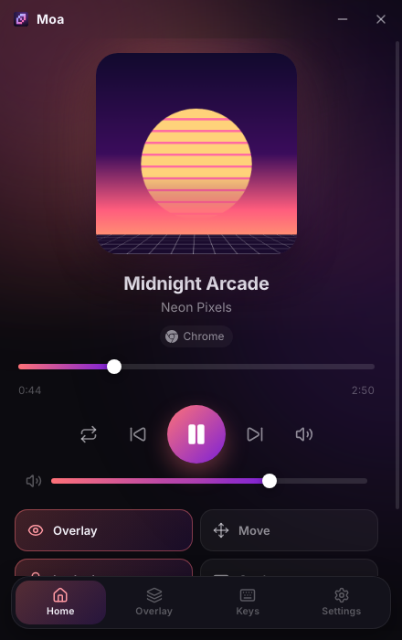
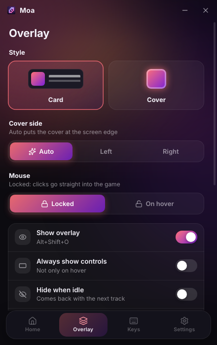
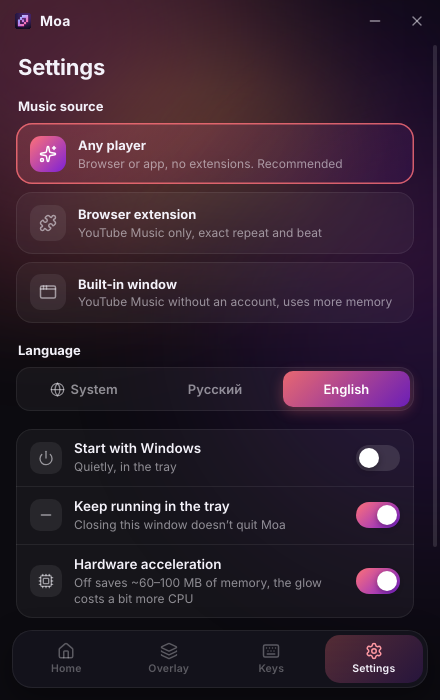

<div align="center">


**A music overlay that sits on top of your games and works with any player.<br>YouTube Music, Spotify, Yandex Music, SoundCloud… Control it with global hotkeys.**

[](https://github.com/godes2020/maol/releases/latest)
[](https://github.com/godes2020/maol/releases)
[](#-download--install)
[](LICENSE)

**English** · [Русский](README.ru.md)

[**⬇ Download for Windows**](https://github.com/godes2020/maol/releases/latest) · [Install guide](docs/INSTALL.md) · [Hotkeys](#-hotkeys) · [Memory](#-memory) · [FAQ](#-faq)

<br>


</div>

---

## ✨ Features

|   |   |
|---|---|
| 🎵 **Any player, no setup** | Moa reads the Windows media controls, so it picks up whatever is playing: YouTube Music, Spotify, Yandex Music, SoundCloud, Apple Music, Deezer, VK, TIDAL, in any browser or desktop app. You sign in on the service's own site or app, as usual. No extensions and no passwords in Moa. |
| 🪟 **In-game overlay** | A small player floats on top of every window, like the Discord overlay. |
| 🖱 **Never in the way** | By default the overlay is **locked**: clicks go straight through it into your game, so you can click freely in Dota 2 or CS2. |
| 💿 **Two styles** | **Card** shows the cover, title and artist. **Cover** shows only the cover with its progress ring; when you point at it, controls appear on top of the cover. |
| ↔️ **Fits any corner** | Drag the corner to resize it. On the right half of the screen the card mirrors itself so the cover stays at the edge, and near the bottom it unfolds upwards. |
| 🌈 **Smooth beat glow** | The colours come from the cover, and the glow softly breathes with the bass. |
| ⌨️ **Global hotkeys** | Play/pause, next/previous, seek, volume, mute and repeat work everywhere, even in a fullscreen game. Every hotkey can be rebound. |
| 🪶 **Light** | Moa runs only what it needs: about 200 MB of RAM with the overlay ([details](#-memory)). |

<div align="center">


<br><sub>Card · Cover</sub>
</div>

## ⬇ Download & install

1. Download **`Moa-Setup-x.y.z.exe`** from the [**latest release**](https://github.com/godes2020/maol/releases/latest) and run it. If Windows says *“Windows protected your PC”*, click **More info → Run anyway**. The app isn't code-signed yet.
2. Moa opens its window and adds an icon to the tray.
3. Play music anywhere: click a service on Moa's home screen to open it in your browser, sign in there and press play. Desktop apps like Spotify work too. The overlay appears in the top-left corner. 🎉

> 📖 The [step-by-step install guide](docs/INSTALL.md) also covers updating, uninstalling and troubleshooting.

### 🧪 Native preview 0.5.0

A rewrite of Moa in Rust is available for testing: **one 11 MB `.exe`, no installer, about 10 MB of private memory at idle** (38 MB working set; measured on Windows in CI).
Download `Moa-0.5.0-preview-x64.exe` from the [**v0.5.0 pre-release**](https://github.com/godes2020/maol/releases/tag/v0.5.0) and run it. It is new in this build:
- **Built-in player**: Yandex Music, SoundCloud, VK or YouTube Music in a WebView2 window (*Settings → Music source → Player in Moa → Open player*). The browser engine is loaded only when you open it.
- **Spotify sign-in** with the official OAuth (PKCE) flow; see the in-app guide for the Client ID.

It is a test build: please report what does not work in [Issues](https://github.com/godes2020/maol/issues). Details in the [install guide](docs/INSTALL.md#native-preview-050).

## 🏠 The Moa window

<div align="center">



</div>

Click the tray icon to open it. One window holds everything:

- **Home**: the current track with seek, volume and playback buttons, plus quick toggles for the overlay. When nothing is playing, it shows one-click links to the music services.
- **Overlay**: style, cover side, mouse behaviour, beat glow, size and opacity.
- **Keys**: every hotkey, plus the seek and volume steps.
- **Settings**: music source, language, startup, memory saving.

When you close the window, it is unloaded from memory, and Moa keeps running in the tray.

## ⌨ Hotkeys

Change any of them on the **Keys** tab: click a shortcut and press a new combination.

| Action | Default |
|---|---|
| Play / pause | <kbd>Alt</kbd>+<kbd>Shift</kbd>+<kbd>K</kbd> |
| Next / previous track | <kbd>Alt</kbd>+<kbd>Shift</kbd>+<kbd>→</kbd> / <kbd>←</kbd> |
| Seek forward / back 5 s | <kbd>Alt</kbd>+<kbd>Shift</kbd>+<kbd>L</kbd> / <kbd>J</kbd> |
| Volume up / down | <kbd>Alt</kbd>+<kbd>Shift</kbd>+<kbd>↑</kbd> / <kbd>↓</kbd> |
| Mute | <kbd>Alt</kbd>+<kbd>Shift</kbd>+<kbd>0</kbd> |
| Repeat | <kbd>Alt</kbd>+<kbd>Shift</kbd>+<kbd>R</kbd> |
| Show / hide overlay | <kbd>Alt</kbd>+<kbd>Shift</kbd>+<kbd>O</kbd> |
| **Move overlay** | <kbd>Alt</kbd>+<kbd>Shift</kbd>+<kbd>M</kbd> |
| **Lock / unlock overlay** | <kbd>Alt</kbd>+<kbd>Shift</kbd>+<kbd>U</kbd> |
| Open Moa | <kbd>Alt</kbd>+<kbd>Shift</kbd>+<kbd>Y</kbd> |

## 🪟 The overlay

<table>
<tr>
<td align="center" width="50%"><br><b>Card</b></td>
<td align="center" width="50%"><br><b>Card on the right side</b><br><sub>Mirrored automatically, so the cover stays at the screen edge.</sub></td>
</tr>
<tr>
<td align="center"><br><b>Full player</b><br><sub>Opens on hover (if unlocked) or in move mode.</sub></td>
<td align="center"><br><b>Move mode</b> (<kbd>Alt</kbd>+<kbd>Shift</kbd>+<kbd>M</kbd>)<br><sub>Drag it, resize it by the corner, mirror it ⇄, switch style, ✓ to finish.</sub></td>
</tr>
<tr>
<td align="center"> <br><b>Cover</b><br><sub>Point at it and the controls appear on top of the cover. Nothing unfolds.</sub></td>
<td align="center"><br><b>Cover in move mode</b></td>
</tr>
</table>

**Mouse behaviour** (on the **Overlay** tab, or with <kbd>Alt</kbd>+<kbd>Shift</kbd>+<kbd>U</kbd>):
- **Locked** (default, made for games): the overlay ignores the mouse completely. Its buttons work only in move mode.
- **On hover**: when you point at the overlay, it opens and its buttons can be clicked.

## 🪶 Memory

Measured with the overlay running and music playing. These are private memory figures for all of Moa's processes on a test machine; Windows numbers may differ by ±20%.

| What is running | RAM |
|---|---|
| Overlay, nothing playing | ~180 MB |
| Overlay + Cover style + beat glow | ~210 MB |
| Overlay + Card style + beat glow | ~240 MB |
| …beat glow turned off | ~200 MB |
| + the Moa window open | +40–60 MB (freed when you close it) |
| *For comparison:* the built-in YouTube Music window | ~450–700 MB |

In the native preview 0.5.0, Moa idles at **~10 MB private memory** (38 MB working set) in a single process. The built-in player adds the WebView2 engine only while it is open.

How Moa saves memory:
- **One small background helper** (`MoaMedia.exe`, 21 KB, about 15 MB of RAM). It reads the Windows media controls, changes the player's volume in the Windows mixer, and analyses the beat using the Windows audio API.
- **The Moa window is created only when you open it** and is destroyed when you close it.
- **The built-in YouTube Music window and the extension server only run in their own modes.**
- **The beat analysis runs only while music is playing**, and the overlay animation idles when nothing moves.
- **Hardware acceleration can be turned off** (*Settings*). This removes the GPU process, which uses about 60–100 MB on Windows, at the cost of a little more CPU for the glow.

## ❓ FAQ

<details>
<summary><b>Which players work?</b></summary>

Every player that appears in the Windows media flyout (the panel that pops up when you press a media key or change the volume): YouTube Music, Spotify (app and web), Yandex Music (app and web), SoundCloud, Apple Music, Deezer, VK Music, TIDAL, YouTube, and most other sites in Chrome, Edge, Yandex Browser, Opera, Brave, Firefox and Zen. Some players don't expose a repeat control or a timeline. In that case Moa says so instead of guessing.
</details>

<details>
<summary><b>Why can't I sign in inside Moa?</b></summary>

Google, Spotify and others don't let third-party apps play music with your account. Google even blocks sign-in inside app windows. Getting around that would mean tricking their protection or copying your cookies, and Moa won't do either. Instead, you sign in where you always do (the site in your browser, or the official app), and Moa simply follows what plays there. The home screen buttons open each service in your browser in one click.
</details>

<details>
<summary><b>Does the overlay work in fullscreen games (Dota 2, CS2…)?</b></summary>

Yes, in **Borderless window** or **Windowed / Desktop-friendly fullscreen** mode, which looks exactly like fullscreen. In **exclusive fullscreen**, Windows does not let any app draw over the game. Only injecting code into the game could, and anti-cheat systems ban for that. In Dota 2: *Settings → Video → Display Mode → Borderless Window*. Hotkeys work in every mode.
</details>

<details>
<summary><b>How do volume and the glow work without access to the player?</b></summary>

Volume hotkeys change the player's own slider in the Windows volume mixer (for example, Chrome's or Spotify's), not the system volume or your game. The glow listens to the sound Windows plays, entirely on your PC. Loud game sounds can therefore make it pulse too. If that bothers you, lower the glow strength or turn the glow off on the **Overlay** tab.
</details>

<details>
<summary><b>The overlay says “Nothing playing”</b></summary>

Make sure the music shows up in the Windows media flyout (press a media key or a volume key). Some players publish media info only after the first play. Open Moa: the line at the bottom of the home screen shows whether Moa sees the Windows media controls.
</details>

<details>
<summary><b>A hotkey doesn't work</b></summary>

Another app or the game is already using it. On the **Keys** tab, shortcuts Moa couldn't register are highlighted in orange, so pick another one. If <kbd>Alt</kbd>+<kbd>Shift</kbd> switches your keyboard layout, change the layout shortcut to <kbd>Win</kbd>+<kbd>Space</kbd>, or rebind Moa to <kbd>Ctrl</kbd>+<kbd>Alt</kbd>+….
</details>

<details>
<summary><b>What are the other music sources?</b></summary>

On **Settings → Music source**:
- **Any player** (default) is described above.
- **Browser extension**: the optional Moa Connector extension for YouTube Music. It reads the tab directly, so repeat and the beat come from that tab only. See the [install guide](docs/INSTALL.md#optional-browser-extension).
- **Built-in window**: YouTube Music inside Moa, without an account (Google blocks sign-in there). It uses the most memory.
</details>

<details>
<summary><b>Is my data sent anywhere?</b></summary>

No. Moa has no servers, no analytics and no telemetry. It only talks to Windows on your PC (and to the extension over `127.0.0.1`, if you use it). Settings are stored in `%APPDATA%\Moa\config.json`.
</details>

## 🛠 Build from source

Requirements: Node.js 20+. To build the media helper on Windows, you also need the .NET SDK.

```bash
git clone https://github.com/godes2020/maol.git
```

```bash
cd maol
```

```bash
npm install
```

```bash
dotnet publish helper/MoaMedia -c Release -o build/helper
```

```bash
npm start
```

On Linux or macOS, you can try the “Any player” source with a stand-in helper instead: `MOA_MEDIA_HELPER=scripts/fake-media-helper.js npm start`.

To build the installer, run `npm run dist`. To regenerate the README images and GIFs, run `npm run media`. Releases are built by [GitHub Actions](.github/workflows/release.yml).

<details>
<summary>Project structure</summary>

```
src/
├── main/        # Electron main process: windows, tray, hotkeys, config, media sources
├── preload/     # Secure bridges between pages and the main process
├── overlay/     # The overlay (HTML/CSS/JS)
├── settings/    # The Moa window
└── shared/      # i18n strings (EN/RU), icons
helper/MoaMedia/ # C# helper: Windows media controls, app volume, beat analysis (WASAPI)
extension/       # Optional Moa Connector browser extension for YouTube Music
scripts/         # check.js, capture-media.js, fake-media-helper.js
```
</details>

## 🗺 Roadmap

- [x] Any player through the Windows media controls
- [x] Firefox and Zen support for the extension
- [ ] Native Rust version (0.5.0 preview: testing)
- [ ] Glow from the player's sound only (per-app audio capture)
- [ ] Like / dislike and lyrics in the overlay
- [ ] macOS and Linux builds

## 📄 License

[MIT](LICENSE) © godes2020. Icons: [Lucide](https://lucide.dev) (ISC) and [Simple Icons](https://simpleicons.org) (CC0).

<sub>Moa is an unofficial, independent project. It is not affiliated with, endorsed by or sponsored by Google, YouTube, Spotify, Yandex, SoundCloud, Apple, Deezer, VK or TIDAL. All product names and logos are trademarks of their respective owners and are shown only to indicate compatibility.</sub>
