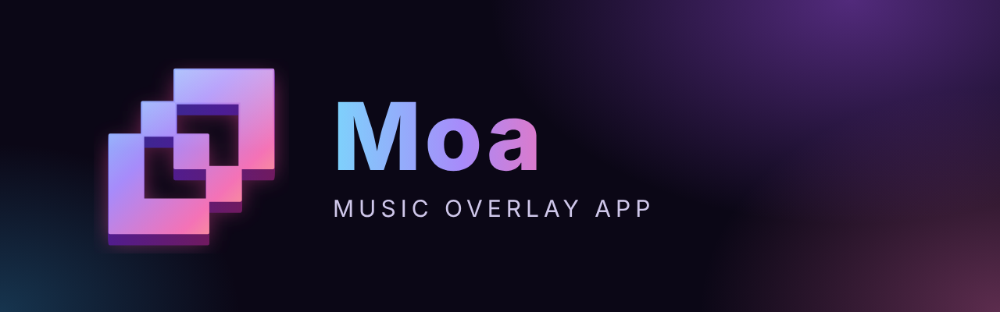
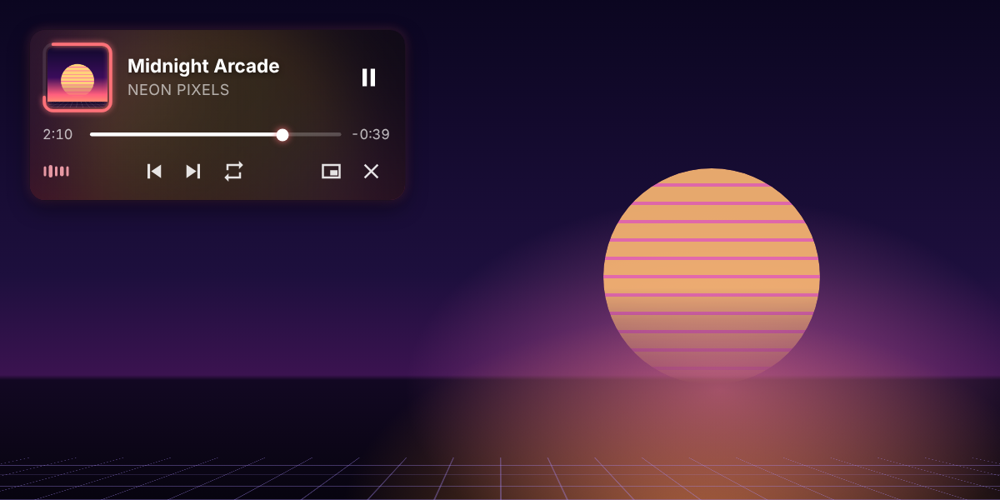
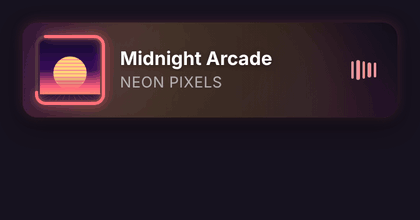
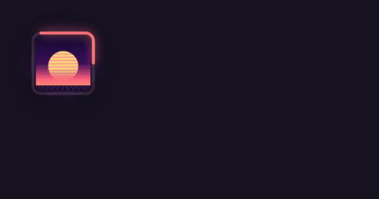
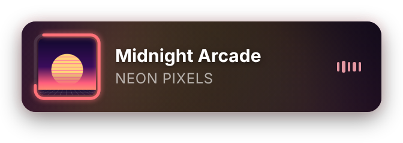
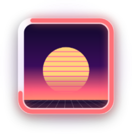
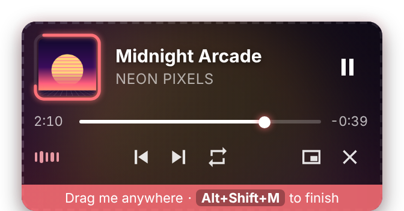
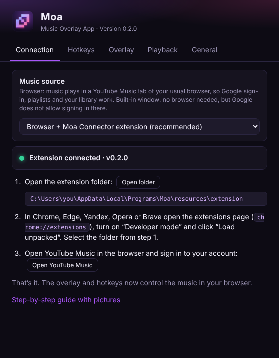
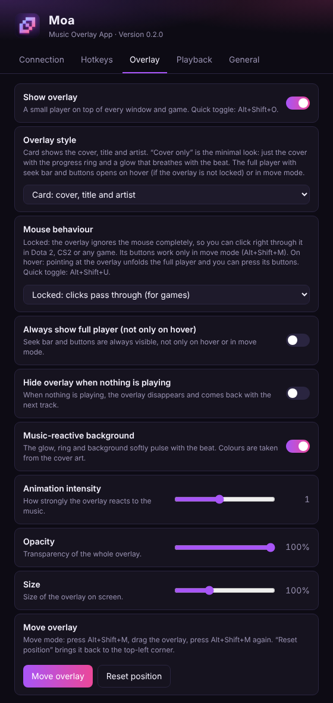

<div align="center">



**A music-reactive overlay for YouTube Music that sits on top of your games.<br>Control playback with global hotkeys without leaving the game.**

[](https://github.com/godes2020/maol/releases/latest)
[](https://github.com/godes2020/maol/releases)
[](#-download--install)
[](LICENSE)

**English** · [Русский](README.ru.md)

[**⬇ Download for Windows**](https://github.com/godes2020/maol/releases/latest) · [Install guide](docs/INSTALL.md) · [Hotkeys](#-hotkeys) · [FAQ](#-faq)

<br>



</div>

---

## ✨ Features

|   |   |
|---|---|
| 🎵 **Your YouTube Music** | Music plays in your usual browser (Chrome, Edge, Yandex, Opera, Brave, Firefox, Zen), so Google sign-in, playlists, your library and recommendations all work. The small **Moa Connector** extension links the browser tab to Moa. |
| 🪟 **In-game overlay** | A small player floats on top of every window, like the Discord overlay. Moa has no window of its own, just the overlay and a tray icon. |
| 🖱 **Never in the way** | By default the overlay is **locked**: every click goes straight through it to your game. You can click on it freely in Dota 2 or CS2. The buttons only work in move mode, or switch it to “opens on hover”. |
| 💿 **Two styles** | **Card** shows the cover, title and artist. **Cover only** shows just the cover with its progress ring and beat glow, and unfolds into the full player when needed. |
| 🌈 **Smooth beat glow** | Colours come from the cover. The glow, ring and background softly breathe with the bass and the beat, with no flicker. |
| ⌨️ **Global hotkeys** | Play/pause, next/previous, seek, volume, mute and repeat work everywhere, even in a fullscreen game. You can rebind every one. |
| 🧲 **Move it anywhere** | Press <kbd>Alt</kbd>+<kbd>Shift</kbd>+<kbd>M</kbd>, drag the overlay, and press the same keys again. |
| 🌍 **English & Russian** | Every setting has a short explanation in both languages. |

<div align="center">


<br><sub>Card style · Cover-only style</sub>
</div>

## ⬇ Download & install

1. Download **`Moa-Setup-x.y.z.exe`** from the [**latest release**](https://github.com/godes2020/maol/releases/latest) and run it. If Windows says *“Windows protected your PC”*, click **More info → Run anyway**. The app isn't code-signed yet.
2. Moa starts in the tray and opens **Settings → Connection**.
3. Click **Open folder**. In your browser, open `chrome://extensions` (or `edge://extensions`), turn on **Developer mode**, click **Load unpacked** and select that folder. Firefox / Zen: [see the guide](docs/INSTALL.md#firefox-zen-librewolf-floorp).
4. Open [music.youtube.com](https://music.youtube.com) in the browser, sign in and play a song. The overlay appears in the top-left corner. 🎉

> 📖 The [step-by-step install guide](docs/INSTALL.md) covers every step with pictures, plus updating, uninstalling and troubleshooting.

## ⌨ Hotkeys

Change any of them in **Settings → Hotkeys**: click a shortcut and press a new combination.

| Action | Default |
|---|---|
| Play / pause | <kbd>Alt</kbd>+<kbd>Shift</kbd>+<kbd>K</kbd> |
| Next track | <kbd>Alt</kbd>+<kbd>Shift</kbd>+<kbd>→</kbd> |
| Previous track | <kbd>Alt</kbd>+<kbd>Shift</kbd>+<kbd>←</kbd> |
| Seek forward 5 s | <kbd>Alt</kbd>+<kbd>Shift</kbd>+<kbd>L</kbd> |
| Seek backward 5 s | <kbd>Alt</kbd>+<kbd>Shift</kbd>+<kbd>J</kbd> |
| Volume up / down | <kbd>Alt</kbd>+<kbd>Shift</kbd>+<kbd>↑</kbd> / <kbd>↓</kbd> |
| Mute / unmute | <kbd>Alt</kbd>+<kbd>Shift</kbd>+<kbd>0</kbd> |
| Repeat: off → playlist → track | <kbd>Alt</kbd>+<kbd>Shift</kbd>+<kbd>R</kbd> |
| Show / hide overlay | <kbd>Alt</kbd>+<kbd>Shift</kbd>+<kbd>O</kbd> |
| **Move overlay (edit mode)** | <kbd>Alt</kbd>+<kbd>Shift</kbd>+<kbd>M</kbd> |
| **Lock / unlock overlay** (click-through ↔ opens on hover) | <kbd>Alt</kbd>+<kbd>Shift</kbd>+<kbd>U</kbd> |
| Show the player (YouTube Music tab) | <kbd>Alt</kbd>+<kbd>Shift</kbd>+<kbd>Y</kbd> |
| Open settings | *not set* |

> 💡 <kbd>J</kbd> / <kbd>K</kbd> / <kbd>L</kbd> mean back / pause / forward, the same as on YouTube.

## 🪟 The overlay

<table>
<tr>
<td align="center" width="50%"><br><b>Card</b><br><sub>Cover with progress ring, title, artist and a live equalizer.</sub></td>
<td align="center" width="50%"><br><b>Cover only</b><br><sub>Just the cover, the ring and a glow that breathes with the beat.</sub></td>
</tr>
<tr>
<td align="center"><br><b>Full player</b><br><sub>Seek bar, play/pause, previous/next, repeat, mute and the open-player and hide buttons.</sub></td>
<td align="center"><br><b>Move mode</b> (<kbd>Alt</kbd>+<kbd>Shift</kbd>+<kbd>M</kbd>)<br><sub>Drag it anywhere and press the buttons. Press the hotkey again to lock it.</sub></td>
</tr>
</table>

**Mouse behaviour.** Choose it in **Settings → Overlay**:
- **Locked** (default, made for games): the overlay is completely transparent to the mouse, so clicks land in the game. Its buttons are available only in move mode.
- **Opens on hover**: pointing at the overlay unfolds the full player and its buttons can be clicked.

You can switch between the two at any time with <kbd>Alt</kbd>+<kbd>Shift</kbd>+<kbd>U</kbd>.

**How the glow works.** The Moa Connector reads the audio of the YouTube Music tab through the Web Audio API, entirely on your PC. The overlay eases towards the bass level every frame and lights up softly on each beat, then fades out over roughly one beat. That's why the glow breathes instead of flickering.

## ⚙ Settings

<div align="center">


</div>

To open the settings, right-click the **tray icon** and choose **Settings…**. Every option has a short explanation right under it.

- **Connection**: music source (browser + extension, or the built-in window), connection status and setup steps.
- **Hotkeys**: rebind any action, unbind it with <kbd>Backspace</kbd>, or reset everything to the defaults.
- **Overlay**: style (card or cover only), mouse behaviour (locked or opens on hover), always show the full player, hide when idle, beat glow and its strength, opacity, size, position.
- **Playback**: seek step and volume step.
- **General**: language, launch with Windows, tray behaviour, and whether to show the Moa window (off by default).

## ❓ FAQ

<details>
<summary><b>Does the overlay work in fullscreen games (Dota 2, CS2…)?</b></summary>

Yes, in **Borderless window** or **Windowed / Desktop-friendly fullscreen** mode, which looks exactly like fullscreen. In **exclusive fullscreen** Windows does not let any app draw over the game. Only injecting code into the game could, and anti-cheat systems ban for that, so Moa doesn't. In Dota 2 go to *Settings → Video → Display Mode* and pick *Borderless Window* or *Desktop-Friendly Fullscreen*. Hotkeys work in every mode.
</details>

<details>
<summary><b>Why does the music play in my browser and not in Moa?</b></summary>

Google blocks signing in from windows built into apps (*“This browser or app may not be secure”*). That's a deliberate Google security rule, and Moa respects it instead of trying to trick it. In your real browser, sign-in works normally, and the Moa Connector extension passes the track, the progress, the audio for the glow and your hotkey commands between the tab and Moa. If you don't need an account, you can switch to the **built-in window** in *Settings → Connection*.
</details>

<details>
<summary><b>The overlay says “Nothing playing”</b></summary>

Check three things:
- Moa is running (look for the tray icon).
- The extension is enabled. Its popup shows a green dot next to **Connected to Moa**.
- A YouTube Music tab is open. If the tab was open before you installed the extension, reload it with <kbd>F5</kbd>.
</details>

<details>
<summary><b>A hotkey doesn't work</b></summary>

Another app or the game may already use that combination. In **Settings → Hotkeys**, any shortcut Moa couldn't register is highlighted in orange. Pick a different combination.
</details>

<details>
<summary><b>Pressing Alt+Shift switches my keyboard layout</b></summary>

Windows switches the layout when <kbd>Alt</kbd>+<kbd>Shift</kbd> are pressed and released without a third key. Moa's combinations normally don't trigger it. If they do, rebind Moa to <kbd>Ctrl</kbd>+<kbd>Alt</kbd>+… or change the layout shortcut to <kbd>Win</kbd>+<kbd>Space</kbd>.
</details>

<details>
<summary><b>Is my data sent anywhere?</b></summary>

No. Moa and the extension talk only to each other, over a local connection (`127.0.0.1`) that accepts only browser extensions. There are no servers, no analytics and no telemetry. Settings are stored in `%APPDATA%\Moa\config.json`.
</details>

## 🛠 Build from source

```bash
git clone https://github.com/godes2020/maol.git
```

```bash
cd maol
```

```bash
npm install
```

```bash
npm start
```

To build the Windows installer, run `npm run dist`. To regenerate the README images and GIFs, run `npm run media`.

<details>
<summary>Project structure</summary>

```
src/
├── main/        # Electron main process: windows, tray, hotkeys, config, local connector server
├── preload/     # Secure bridges between pages and the main process
├── overlay/     # The overlay UI (HTML/CSS/JS)
├── settings/    # The settings window
└── shared/      # i18n strings (EN/RU)
extension/       # Moa Connector browser extension (also holds ytm-bridge.js, shared with the built-in window)
scripts/         # check.js (syntax check), capture-media.js (README images/GIFs)
```
</details>

Releases are built by [GitHub Actions](.github/workflows/release.yml): run the **Release** workflow with *publish* ticked, or push a `v*` tag.

## 🗺 Roadmap

- [ ] Publish Moa Connector to the Chrome Web Store (one-click install)
- [x] Firefox and Zen support
- [ ] Spotify and Yandex Music support
- [ ] Like / dislike and lyrics in the overlay
- [ ] macOS and Linux builds

## 📄 License

[MIT](LICENSE) © godes2020

<sub>Moa is an unofficial, independent project. It is not affiliated with, endorsed by or sponsored by Google LLC or YouTube. “YouTube” and “YouTube Music” are trademarks of Google LLC.</sub>
