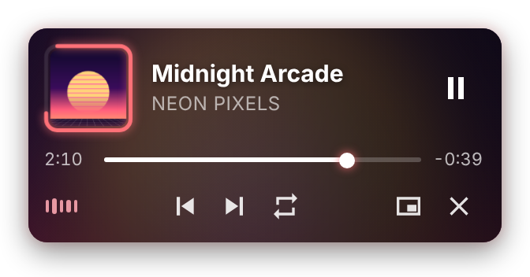
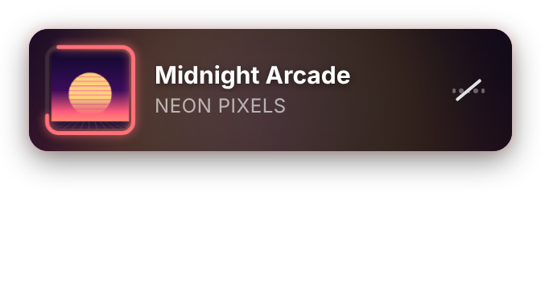
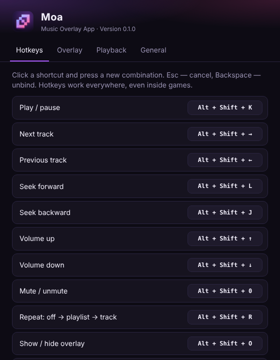

<div align="center">


**YouTube Music on your desktop, plus a compact, music-reactive overlay that stays on top of your games.<br>Control everything with global hotkeys without leaving the game.**

[](https://github.com/godes2020/maol/releases/latest)
[](https://github.com/godes2020/maol/releases)
[](#-download--install)
[](LICENSE)

**English** · [Русский](README.ru.md)

[**⬇ Download for Windows**](https://github.com/godes2020/maol/releases/latest) · [Install guide](docs/INSTALL.md) · [Hotkeys](#-hotkeys) · [FAQ](#-faq)

<br>


</div>

---

## ✨ Features

|   |   |
|---|---|
| 🎵 **Full YouTube Music** | Sign in to your Google account and use playlists, your library, recommendations, search and radio, all inside one compact window. |
| 🪟 **In-game overlay** | A small player that floats on top of every window, like the Discord overlay. Mouse clicks pass straight through it to your game. |
| 💿 **Progress ring** | A square cover whose border fills up as the track plays. |
| 🌈 **Music-reactive background** | The card picks its colours from the cover art, pulses on the bass, flashes on beats and follows the track's tempo. |
| 🖱 **Hover to expand** | Hover the overlay to get a seek bar, time, previous/next, repeat, mute and more. |
| ⌨️ **Global hotkeys** | Play/pause, next/previous, seek, volume, mute and repeat work everywhere, even in a fullscreen game. You can rebind every one. |
| 🧲 **Move it anywhere** | Press <kbd>Alt</kbd>+<kbd>Shift</kbd>+<kbd>M</kbd>, drag the overlay where you want it, and press the same keys again. Moa remembers the spot. |
| 🌍 **English & Russian** | The interface follows your system language. You can switch it in the settings. |

<div align="center">

<br><sub>Compact → hover → volume change → mute</sub>
</div>

## ⬇ Download & install

1. Open the [**latest release**](https://github.com/godes2020/maol/releases/latest).
2. Download **`Moa-Setup-x.y.z.exe`** (installer) or **`Moa-x.y.z-portable.exe`** (no installation).
3. Run it. Windows may show **“Windows protected your PC”** because the app is not code-signed yet. Click **More info → Run anyway**.
4. Moa opens in a small window. Click **Sign in** (top-right) and log in to your Google account.
5. Pick a song and the overlay shows up in the top-left corner of your screen. 🎉

> 📖 The [step-by-step install guide](docs/INSTALL.md) has screenshots, an update guide, uninstall steps and troubleshooting.

## ⌨ Hotkeys

The default hotkeys are listed below. You can change any of them in **Settings → Hotkeys**: click a shortcut and press a new combination.

| Action | Default |
|---|---|
| Play / pause | <kbd>Alt</kbd>+<kbd>Shift</kbd>+<kbd>K</kbd> |
| Next track | <kbd>Alt</kbd>+<kbd>Shift</kbd>+<kbd>→</kbd> |
| Previous track | <kbd>Alt</kbd>+<kbd>Shift</kbd>+<kbd>←</kbd> |
| Seek forward 5 s | <kbd>Alt</kbd>+<kbd>Shift</kbd>+<kbd>L</kbd> |
| Seek backward 5 s | <kbd>Alt</kbd>+<kbd>Shift</kbd>+<kbd>J</kbd> |
| Volume up / down | <kbd>Alt</kbd>+<kbd>Shift</kbd>+<kbd>↑</kbd> / <kbd>↓</kbd> |
| Mute / unmute | <kbd>Alt</kbd>+<kbd>Shift</kbd>+<kbd>0</kbd> |
| Repeat: off → playlist → track | <kbd>Alt</kbd>+<kbd>Shift</kbd>+<kbd>R</kbd> |
| Show / hide overlay | <kbd>Alt</kbd>+<kbd>Shift</kbd>+<kbd>O</kbd> |
| **Move overlay (edit mode)** | <kbd>Alt</kbd>+<kbd>Shift</kbd>+<kbd>M</kbd> |
| Show / hide the Moa window | <kbd>Alt</kbd>+<kbd>Shift</kbd>+<kbd>Y</kbd> |
| Open settings | *not set* |

> 💡 <kbd>J</kbd> / <kbd>K</kbd> / <kbd>L</kbd> mean back / pause / forward, the same as on YouTube. The seek step and volume step are adjustable in **Settings → Playback**.

## 🪟 The overlay

<table>
<tr>
<td align="center" width="50%"><br><b>Compact</b><br><sub>Cover with progress ring, title, artist and a live equalizer that doubles as a mute button.</sub></td>
<td align="center" width="50%"><br><b>On hover</b><br><sub>Seek bar, play/pause, previous/next, repeat, open Moa and hide overlay buttons.</sub></td>
</tr>
<tr>
<td align="center"><br><b>Edit mode</b> (<kbd>Alt</kbd>+<kbd>Shift</kbd>+<kbd>M</kbd>)<br><sub>Drag the overlay anywhere and press the hotkey again to lock it.</sub></td>
<td align="center"><br><b>Muted</b><br><sub>The equalizer flattens and gets crossed out.</sub></td>
</tr>
</table>

**How the background reacts.** Moa reads the audio that YouTube Music plays through the Web Audio API, entirely on your PC. The bass makes the cover, glow and blurred background pulse, and detected beats trigger a soft flash. The drift animation speeds up or slows down to match the estimated BPM. You can turn this off or change its intensity in **Settings → Overlay**.

## ⚙ Settings

<div align="center"></div>

To open the settings, right-click the **tray icon** and choose **Settings…**, or press <kbd>Ctrl</kbd>+<kbd>,</kbd> in the Moa window.

- **Hotkeys**: rebind any action, unbind it with <kbd>Backspace</kbd>, or reset everything to the defaults.
- **Overlay**: show or hide it, always show the full player, hide it when nothing is playing, change opacity and size, turn the reactive background and its intensity on or off, and move or reset the overlay position.
- **Playback**: seek step (1–30 s) and volume step (1–20 %).
- **General**: language, launch with Windows, keep running in the tray when the window is closed, start minimized.

## ❓ FAQ

<details>
<summary><b>The overlay isn't visible in my game</b></summary>

Moa draws a normal always-on-top window, so it shows over games running in **Windowed** or **Borderless / Fullscreen windowed** mode. In **exclusive fullscreen** the game takes over the screen and no regular window can be drawn on top. The only way around that is injecting code into the game, which anti-cheat systems can punish. Switch the game to *Borderless*. Hotkeys keep working in any mode.
</details>

<details>
<summary><b>A hotkey doesn't work</b></summary>

Another app (or the game itself) may already use that combination. Open **Settings → Hotkeys**. Any shortcut Moa couldn't register is highlighted in orange. Pick a different combination.
</details>

<details>
<summary><b>Pressing Alt+Shift switches my keyboard layout</b></summary>

On Windows, pressing and releasing <kbd>Alt</kbd>+<kbd>Shift</kbd> on their own switches the layout. Combinations with a third key, like the ones Moa uses, normally don't. If it still bothers you, either rebind Moa's hotkeys to <kbd>Ctrl</kbd>+<kbd>Alt</kbd>+… or change the layout switch to <kbd>Win</kbd>+<kbd>Space</kbd> in Windows settings.
</details>

<details>
<summary><b>Google says “This browser or app may not be secure”</b></summary>

Moa presents itself as a regular Chrome browser, so this is rare. If you see it, close the window, wait a minute and try again, or sign in once with a different method (for example, a security key or phone prompt).
</details>

<details>
<summary><b>Where are my settings stored? Is my data sent anywhere?</b></summary>

Settings are stored in `%APPDATA%\Moa\config.json`. Your YouTube/Google session is stored in the same folder and works exactly like it would in a browser. Moa has no servers, no analytics and no telemetry. The only connections it makes are to YouTube Music and Google.
</details>

<details>
<summary><b>How do I close Moa completely?</b></summary>

Closing the window keeps Moa in the tray so music and hotkeys keep working. To exit, right-click the tray icon and choose **Quit**. You can turn this behaviour off in **Settings → General**.
</details>

## 🛠 Build from source

```bash
git clone https://github.com/godes2020/maol.git
```

```bash
cd maol
```

```bash
npm install
```

```bash
npm start
```

To build the Windows installer, run `npm run dist`. It writes `dist/Moa-Setup-x.y.z.exe` and a portable exe.

<details>
<summary>Project structure</summary>

```
src/
├── main/        # Electron main process: windows, tray, hotkeys, config
├── inject/      # Script injected into music.youtube.com (player state, audio analysis, commands)
├── preload/     # Secure bridges between pages and the main process
├── overlay/     # The overlay UI (HTML/CSS/JS)
├── settings/    # The settings window
└── shared/      # i18n strings (EN/RU)
scripts/         # check.js (syntax check), capture-media.js (README images/GIF)
```
</details>

Releases are built automatically. Pushing a tag like `v0.1.0` makes [GitHub Actions](.github/workflows/release.yml) build the installer and publish it to Releases.

## 🗺 Roadmap

- [ ] Spotify and Yandex Music support
- [ ] Like / dislike from the overlay
- [ ] Lyrics in the overlay
- [ ] More overlay themes and layouts
- [ ] macOS and Linux builds

## 📄 License

[MIT](LICENSE) © godes2020

<sub>Moa is an unofficial, independent project. It is not affiliated with, endorsed by or sponsored by Google LLC or YouTube. “YouTube” and “YouTube Music” are trademarks of Google LLC.</sub>
