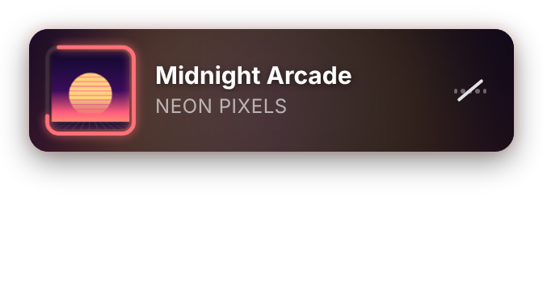
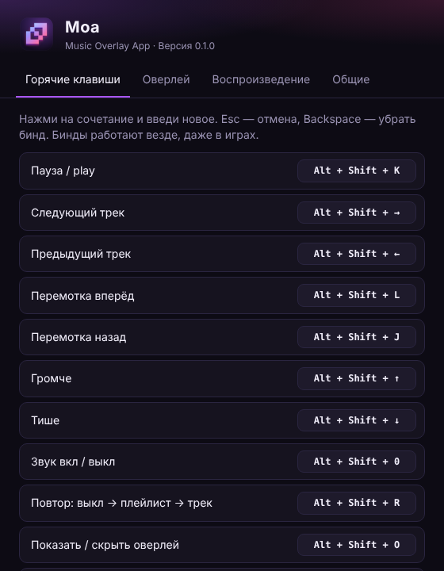

<div align="center">


**YouTube Music на компьютере и компактный оверлей поверх игр, который живёт в такт музыке.<br>Управляй музыкой глобальными биндами и не выходи из игры.**

[](https://github.com/godes2020/maol/releases/latest)
[](https://github.com/godes2020/maol/releases)
[](#-скачать-и-установить)
[](LICENSE)

[English](README.md) · **Русский**

[**⬇ Скачать для Windows**](https://github.com/godes2020/maol/releases/latest) · [Гайд по установке](docs/INSTALL.ru.md) · [Бинды](#-горячие-клавиши) · [FAQ](#-частые-вопросы)

<br>


</div>

---

## ✨ Возможности

|   |   |
|---|---|
| 🎵 **Полноценная YouTube Music** | Входишь в свой Google-аккаунт и получаешь плейлисты, медиатеку, рекомендации, поиск и радио в одном компактном окне. |
| 🪟 **Оверлей поверх игр** | Маленький плеер висит поверх всех окон, как оверлей Discord. Клики сквозь него проходят прямо в игру. |
| 💿 **Кольцо прогресса** | Обложка в квадрате, её рамка заполняется по мере проигрывания трека. |
| 🌈 **Фон реагирует на музыку** | Цвета берутся из обложки. Фон пульсирует на басах, вспыхивает на битах и подстраивается под темп трека. |
| 🖱 **Раскрывается при наведении** | Наведи курсор, и появятся полоса перемотки, время, кнопки назад/вперёд, повтор, звук и другие. |
| ⌨️ **Глобальные бинды** | Пауза, следующий/предыдущий трек, перемотка, громкость, mute и повтор работают везде, даже в полноэкранной игре. Каждый бинд можно переназначить. |
| 🧲 **Ставится куда угодно** | Нажми <kbd>Alt</kbd>+<kbd>Shift</kbd>+<kbd>M</kbd>, перетащи оверлей куда нужно и нажми то же сочетание ещё раз. Moa запомнит место. |
| 🌍 **Русский и английский** | Язык интерфейса берётся из системы, его можно сменить в настройках. |

<div align="center">

<br><sub>Компактный вид → наведение → громкость → без звука</sub>
</div>

## ⬇ Скачать и установить

1. Открой [**последний релиз**](https://github.com/godes2020/maol/releases/latest).
2. Скачай **`Moa-Setup-x.y.z.exe`** (установщик) или **`Moa-x.y.z-portable.exe`** (работает без установки).
3. Запусти файл. Windows может показать **«Система Windows защитила ваш компьютер»**: у приложения пока нет цифровой подписи. Нажми **Подробнее → Выполнить в любом случае**.
4. Moa откроется в маленьком окне. Нажми **Войти** (справа сверху) и войди в Google-аккаунт.
5. Включи любую песню, и в левом верхнем углу экрана появится оверлей. 🎉

> 📖 В [пошаговом гайде по установке](docs/INSTALL.ru.md) есть скриншоты, а также инструкции по обновлению, удалению и решению проблем.

## ⌨ Горячие клавиши

Ниже бинды по умолчанию. Любой из них можно поменять в **Настройки → Горячие клавиши**: нажми на сочетание и введи новое.

| Действие | По умолчанию |
|---|---|
| Пауза / play | <kbd>Alt</kbd>+<kbd>Shift</kbd>+<kbd>K</kbd> |
| Следующий трек | <kbd>Alt</kbd>+<kbd>Shift</kbd>+<kbd>→</kbd> |
| Предыдущий трек | <kbd>Alt</kbd>+<kbd>Shift</kbd>+<kbd>←</kbd> |
| Перемотка вперёд на 5 с | <kbd>Alt</kbd>+<kbd>Shift</kbd>+<kbd>L</kbd> |
| Перемотка назад на 5 с | <kbd>Alt</kbd>+<kbd>Shift</kbd>+<kbd>J</kbd> |
| Громче / тише | <kbd>Alt</kbd>+<kbd>Shift</kbd>+<kbd>↑</kbd> / <kbd>↓</kbd> |
| Звук вкл / выкл | <kbd>Alt</kbd>+<kbd>Shift</kbd>+<kbd>0</kbd> |
| Повтор: выкл → плейлист → трек | <kbd>Alt</kbd>+<kbd>Shift</kbd>+<kbd>R</kbd> |
| Показать / скрыть оверлей | <kbd>Alt</kbd>+<kbd>Shift</kbd>+<kbd>O</kbd> |
| **Переместить оверлей (режим настройки)** | <kbd>Alt</kbd>+<kbd>Shift</kbd>+<kbd>M</kbd> |
| Показать / скрыть окно Moa | <kbd>Alt</kbd>+<kbd>Shift</kbd>+<kbd>Y</kbd> |
| Открыть настройки | *не задано* |

> 💡 <kbd>J</kbd> / <kbd>K</kbd> / <kbd>L</kbd> — это назад / пауза / вперёд, как на YouTube. Шаг перемотки и громкости настраивается в **Настройки → Воспроизведение**.

## 🪟 Оверлей

<table>
<tr>
<td align="center" width="50%"><br><b>Компактный</b><br><sub>Обложка с кольцом прогресса, название, исполнитель и живой эквалайзер, который заодно работает как кнопка mute.</sub></td>
<td align="center" width="50%"><br><b>При наведении</b><br><sub>Перемотка, пауза, назад/вперёд, повтор, кнопки «открыть Moa» и «скрыть оверлей».</sub></td>
</tr>
<tr>
<td align="center"><br><b>Режим настройки</b> (<kbd>Alt</kbd>+<kbd>Shift</kbd>+<kbd>M</kbd>)<br><sub>Перетащи оверлей куда угодно и нажми бинд ещё раз, чтобы закрепить.</sub></td>
<td align="center"><br><b>Без звука</b><br><sub>Эквалайзер опускается и зачёркивается.</sub></td>
</tr>
</table>

**Как работает фон.** Moa анализирует звук, который играет YouTube Music, через Web Audio API, целиком у тебя на компьютере. От баса пульсируют обложка, свечение и размытый фон, на найденных битах фон мягко вспыхивает, а скорость переливов подстраивается под темп (BPM) трека. Эффект можно выключить или ослабить в **Настройки → Оверлей**.

## ⚙ Настройки

<div align="center"></div>

Чтобы открыть настройки, нажми правой кнопкой по **иконке в трее** и выбери **Настройки…**, или нажми <kbd>Ctrl</kbd>+<kbd>,</kbd> в окне Moa.

- **Горячие клавиши**: переназначить любое действие, убрать бинд через <kbd>Backspace</kbd> или сбросить всё по умолчанию.
- **Оверлей**: показать или скрыть, всегда показывать полный плеер, скрывать, когда ничего не играет, прозрачность и размер, реакция фона на музыку и её сила, перемещение и сброс позиции.
- **Воспроизведение**: шаг перемотки (1–30 с) и шаг громкости (1–20 %).
- **Общие**: язык, автозапуск с Windows, работа в трее после закрытия окна, запуск свёрнутым.

## ❓ Частые вопросы

<details>
<summary><b>Оверлей не видно в игре</b></summary>

Moa рисует обычное окно «поверх всех». Поэтому оно видно над играми в режимах **«В окне»** и **«Без рамки / Оконный полноэкранный»**. В **эксклюзивном полноэкранном** режиме игра забирает экран целиком, и обычное окно поверх неё не нарисовать. Обойти это можно только инъекцией кода в игру, а за такое банят античиты. Переключи игру в *Borderless*. Бинды работают в любом режиме.
</details>

<details>
<summary><b>Какой-то бинд не срабатывает</b></summary>

Скорее всего, это сочетание уже занято другой программой или самой игрой. Открой **Настройки → Горячие клавиши**: сочетания, которые не удалось назначить, подсвечены оранжевым. Выбери другое сочетание.
</details>

<details>
<summary><b>Alt+Shift переключает раскладку</b></summary>

В Windows раскладка переключается, когда <kbd>Alt</kbd>+<kbd>Shift</kbd> нажимают и отпускают без других клавиш. Сочетания с третьей клавишей, как у Moa, обычно раскладку не трогают. Если всё равно мешает, поменяй бинды Moa на <kbd>Ctrl</kbd>+<kbd>Alt</kbd>+… или назначь переключение раскладки на <kbd>Win</kbd>+<kbd>Пробел</kbd> в параметрах Windows.
</details>

<details>
<summary><b>Google пишет «Этот браузер или приложение могут быть небезопасными»</b></summary>

Moa представляется обычным браузером Chrome, поэтому такое бывает редко. Если всё-таки появилось, закрой окно, подожди минуту и попробуй снова, либо войди другим способом (например, через подтверждение на телефоне).
</details>

<details>
<summary><b>Где хранятся настройки? Куда-то отправляются мои данные?</b></summary>

Настройки лежат в `%APPDATA%\Moa\config.json`. Сессия YouTube/Google хранится в той же папке и работает так же, как в браузере. У Moa нет своих серверов, аналитики и телеметрии. Приложение подключается только к YouTube Music и Google.
</details>

<details>
<summary><b>Как полностью закрыть Moa?</b></summary>

При закрытии окна Moa остаётся в трее, чтобы музыка и бинды продолжали работать. Чтобы выйти, нажми правой кнопкой по иконке в трее и выбери **Выход**. Это поведение можно отключить в **Настройки → Общие**.
</details>

## 🛠 Сборка из исходников

```bash
git clone https://github.com/godes2020/maol.git
```

```bash
cd maol
```

```bash
npm install
```

```bash
npm start
```

Чтобы собрать установщик для Windows, запусти `npm run dist`. В папке `dist/` появятся `Moa-Setup-x.y.z.exe` и portable-версия.

Релизы собираются автоматически: после пуша тега вида `v0.1.0` [GitHub Actions](.github/workflows/release.yml) собирает установщик и выкладывает его в Releases.

## 🗺 Планы

- [ ] Поддержка Spotify и Яндекс Музыки
- [ ] Лайк / дизлайк из оверлея
- [ ] Текст песни в оверлее
- [ ] Больше тем и вариантов оверлея
- [ ] Сборки для macOS и Linux

## 📄 Лицензия

[MIT](LICENSE) © godes2020

<sub>Moa — неофициальный независимый проект. Он не связан с Google LLC и YouTube и не одобрен ими. «YouTube» и «YouTube Music» — товарные знаки Google LLC.</sub>
