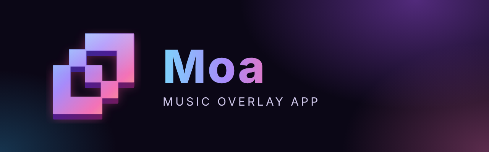
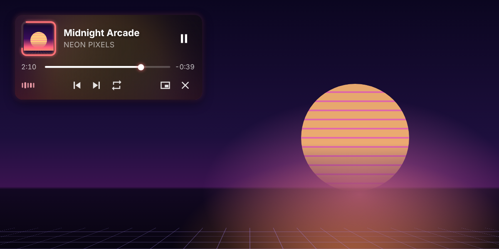
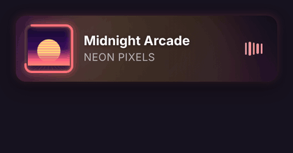
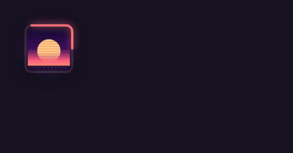
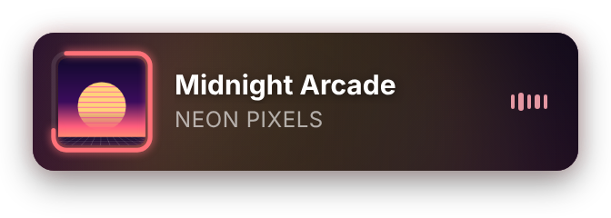
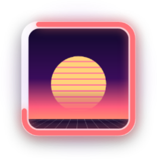
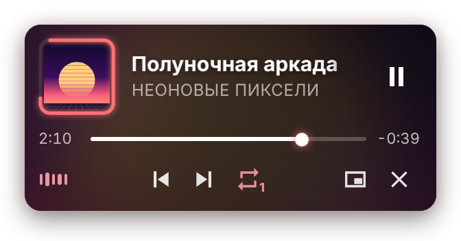
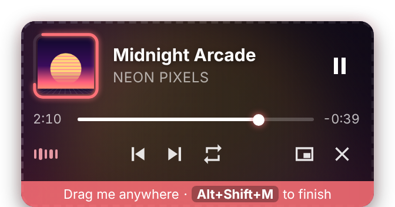
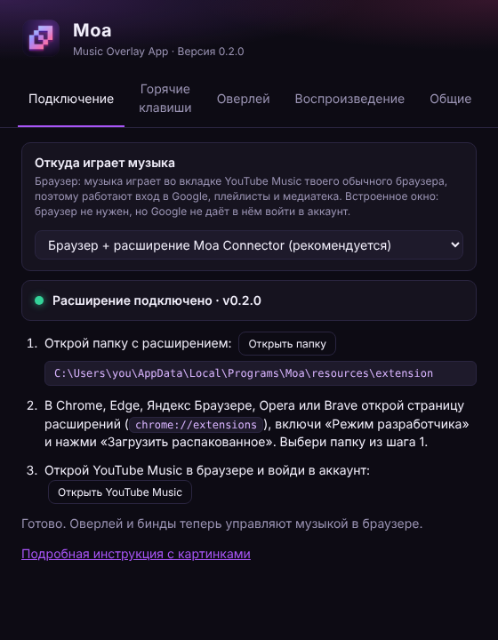
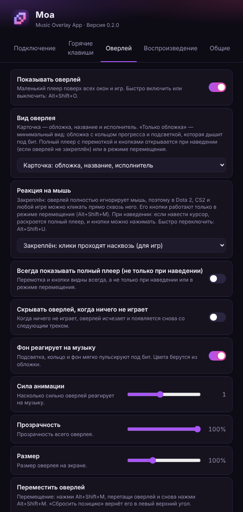

<div align="center">



**Оверлей для YouTube Music поверх игр, который живёт в такт музыке.<br>Управляй музыкой глобальными биндами и не выходи из игры.**

[](https://github.com/godes2020/maol/releases/latest)
[](https://github.com/godes2020/maol/releases)
[](#-скачать-и-установить)
[](LICENSE)

[English](README.md) · **Русский**

[**⬇ Скачать для Windows**](https://github.com/godes2020/maol/releases/latest) · [Гайд по установке](docs/INSTALL.ru.md) · [Бинды](#-горячие-клавиши) · [FAQ](#-частые-вопросы)

<br>



</div>

---

## ✨ Возможности

|   |   |
|---|---|
| 🎵 **Твоя YouTube Music** | Музыка играет в твоём обычном браузере (Chrome, Edge, Яндекс, Opera, Brave, Firefox, Zen), поэтому работают вход в Google, плейлисты, медиатека и рекомендации. Вкладку с Moa связывает маленькое расширение **Moa Connector**. |
| 🪟 **Оверлей поверх игр** | Маленький плеер висит поверх всех окон, как оверлей Discord. Своего окна у Moa нет: только оверлей и иконка в трее. |
| 🖱 **Не мешает играть** | По умолчанию оверлей **закреплён**: все клики проходят сквозь него прямо в игру. В Доте или CS2 можно спокойно кликать прямо по нему. Кнопки работают только в режиме перемещения, или можно включить вариант «раскрывается при наведении». |
| 💿 **Два вида** | **Карточка** показывает обложку, название и исполнителя. **Только обложка** — одна обложка с кольцом прогресса и подсветкой под бит, которая при необходимости раскрывается в полный плеер. |
| 🌈 **Плавная подсветка под бит** | Цвета берутся из обложки. Подсветка, кольцо и фон мягко «дышат» в такт басам и битам, без мерцания. |
| ⌨️ **Глобальные бинды** | Пауза, следующий/предыдущий трек, перемотка, громкость, mute и повтор работают везде, даже в полноэкранной игре. Каждый бинд можно переназначить. |
| 🧲 **Ставится куда угодно** | Нажми <kbd>Alt</kbd>+<kbd>Shift</kbd>+<kbd>M</kbd>, перетащи оверлей и нажми то же сочетание ещё раз. |
| 🌍 **Русский и английский** | У каждой настройки есть короткое пояснение на обоих языках. |

<div align="center">


<br><sub>Вид «Карточка» · Вид «Только обложка»</sub>
</div>

## ⬇ Скачать и установить

1. Скачай **`Moa-Setup-x.y.z.exe`** из [**последнего релиза**](https://github.com/godes2020/maol/releases/latest) и запусти его. Если Windows напишет *«Система Windows защитила ваш компьютер»*, нажми **Подробнее → Выполнить в любом случае**: у приложения пока нет цифровой подписи.
2. Moa запустится в трее и откроет **Настройки → Подключение**.
3. Нажми **Открыть папку**. В браузере открой `chrome://extensions` (или `edge://extensions`), включи **Режим разработчика**, нажми **Загрузить распакованное** и выбери эту папку. Firefox / Zen: [смотри гайд](docs/INSTALL.ru.md#firefox-zen-librewolf-floorp).
4. Открой в браузере [music.youtube.com](https://music.youtube.com), войди в аккаунт и включи песню. В левом верхнем углу появится оверлей. 🎉

> 📖 В [пошаговом гайде](docs/INSTALL.ru.md) каждый шаг расписан с картинками, а ещё есть обновление, удаление и решение проблем.

## ⌨ Горячие клавиши

Любой бинд можно поменять в **Настройки → Горячие клавиши**: нажми на сочетание и введи новое.

| Действие | По умолчанию |
|---|---|
| Пауза / play | <kbd>Alt</kbd>+<kbd>Shift</kbd>+<kbd>K</kbd> |
| Следующий трек | <kbd>Alt</kbd>+<kbd>Shift</kbd>+<kbd>→</kbd> |
| Предыдущий трек | <kbd>Alt</kbd>+<kbd>Shift</kbd>+<kbd>←</kbd> |
| Перемотка вперёд на 5 с | <kbd>Alt</kbd>+<kbd>Shift</kbd>+<kbd>L</kbd> |
| Перемотка назад на 5 с | <kbd>Alt</kbd>+<kbd>Shift</kbd>+<kbd>J</kbd> |
| Громче / тише | <kbd>Alt</kbd>+<kbd>Shift</kbd>+<kbd>↑</kbd> / <kbd>↓</kbd> |
| Звук вкл / выкл | <kbd>Alt</kbd>+<kbd>Shift</kbd>+<kbd>0</kbd> |
| Повтор: выкл → плейлист → трек | <kbd>Alt</kbd>+<kbd>Shift</kbd>+<kbd>R</kbd> |
| Показать / скрыть оверлей | <kbd>Alt</kbd>+<kbd>Shift</kbd>+<kbd>O</kbd> |
| **Переместить оверлей (режим настройки)** | <kbd>Alt</kbd>+<kbd>Shift</kbd>+<kbd>M</kbd> |
| **Закрепить / открепить оверлей** (клики насквозь ↔ раскрывается при наведении) | <kbd>Alt</kbd>+<kbd>Shift</kbd>+<kbd>U</kbd> |
| Показать плеер (вкладку YouTube Music) | <kbd>Alt</kbd>+<kbd>Shift</kbd>+<kbd>Y</kbd> |
| Открыть настройки | *не задано* |

> 💡 <kbd>J</kbd> / <kbd>K</kbd> / <kbd>L</kbd> — это назад / пауза / вперёд, как на YouTube.

## 🪟 Оверлей

<table>
<tr>
<td align="center" width="50%"><br><b>Карточка</b><br><sub>Обложка с кольцом прогресса, название, исполнитель и живой эквалайзер.</sub></td>
<td align="center" width="50%"><br><b>Только обложка</b><br><sub>Одна обложка, кольцо и подсветка, которая дышит под бит.</sub></td>
</tr>
<tr>
<td align="center"><br><b>Полный плеер</b><br><sub>Перемотка, пауза, назад/вперёд, повтор, звук и кнопки «открыть плеер» и «скрыть».</sub></td>
<td align="center"><br><b>Режим перемещения</b> (<kbd>Alt</kbd>+<kbd>Shift</kbd>+<kbd>M</kbd>)<br><sub>Перетащи оверлей куда угодно и понажимай кнопки. Повторное нажатие бинда закрепляет его.</sub></td>
</tr>
</table>

**Реакция на мышь.** Выбирается в **Настройки → Оверлей**:
- **Закреплён** (по умолчанию, сделан для игр): оверлей полностью прозрачен для мыши, и клики попадают в игру. Кнопки доступны только в режиме перемещения.
- **Раскрывается при наведении**: если навести курсор, раскроется полный плеер, и кнопки можно нажимать.

Переключаться между вариантами можно в любой момент биндом <kbd>Alt</kbd>+<kbd>Shift</kbd>+<kbd>U</kbd>.

**Как работает подсветка.** Moa Connector анализирует звук вкладки YouTube Music через Web Audio API, целиком у тебя на компьютере. Оверлей на каждом кадре плавно подтягивается к уровню баса, а на каждом бите мягко вспыхивает и затухает примерно за один бит. Поэтому подсветка дышит, а не мерцает.

## ⚙ Настройки

<div align="center">


</div>

Чтобы открыть настройки, нажми правой кнопкой по **иконке в трее** и выбери **Настройки…**. Под каждой опцией есть короткое пояснение.

- **Подключение**: откуда играет музыка (браузер + расширение или встроенное окно), статус подключения и шаги настройки.
- **Горячие клавиши**: переназначить любое действие, убрать бинд через <kbd>Backspace</kbd> или сбросить всё по умолчанию.
- **Оверлей**: вид (карточка или только обложка), реакция на мышь (закреплён или раскрывается при наведении), всегда полный плеер, скрытие без музыки, подсветка под бит и её сила, прозрачность, размер, позиция.
- **Воспроизведение**: шаг перемотки и громкости.
- **Общие**: язык, автозапуск с Windows, работа в трее и показ окна Moa (по умолчанию выключен).

## ❓ Частые вопросы

<details>
<summary><b>Оверлей работает в полноэкранных играх (Dota 2, CS2…)?</b></summary>

Да, в режиме **«Окно без рамки»** или **«Оконный / Полноэкранный для рабочего стола»**. Выглядит он точно как полный экран. В **эксклюзивном полноэкранном** режиме Windows не даёт ни одной программе рисовать поверх игры. Это можно сделать только инъекцией кода в игру, а за неё банят античиты, поэтому Moa так не делает. В Dota 2: *Настройки → Видео → Режим отображения* → *Окно без рамки* или *Полноэкранный (для рабочего стола)*. Бинды работают в любом режиме.
</details>

<details>
<summary><b>Почему музыка играет в браузере, а не в самой Moa?</b></summary>

Google блокирует вход в аккаунт из окон, встроенных в приложения (*«Возможно, этот браузер или приложение небезопасны»*). Это намеренное правило безопасности Google, и Moa его соблюдает, а не пытается обмануть. В настоящем браузере вход работает как обычно, а расширение Moa Connector передаёт между вкладкой и Moa трек, прогресс, звук для подсветки и команды биндов. Если аккаунт не нужен, можно переключиться на **встроенное окно** в *Настройки → Подключение*.
</details>

<details>
<summary><b>Оверлей пишет «Ничего не играет»</b></summary>

Проверь три вещи:
- Moa запущена (иконка в трее).
- Расширение включено: в его окошке горит зелёная точка у пункта **Moa подключена**.
- Вкладка YouTube Music открыта. Если она была открыта ещё до установки расширения, обнови её клавишей <kbd>F5</kbd>.
</details>

<details>
<summary><b>Какой-то бинд не срабатывает</b></summary>

Это сочетание может быть уже занято другой программой или игрой. В **Настройки → Горячие клавиши** сочетания, которые не удалось назначить, подсвечены оранжевым. Выбери другое.
</details>

<details>
<summary><b>Alt+Shift переключает раскладку</b></summary>

Windows переключает раскладку, когда <kbd>Alt</kbd>+<kbd>Shift</kbd> нажимают и отпускают без третьей клавиши. Сочетания Moa обычно этого не делают. Если всё же мешает, поменяй бинды на <kbd>Ctrl</kbd>+<kbd>Alt</kbd>+… или назначь смену раскладки на <kbd>Win</kbd>+<kbd>Пробел</kbd>.
</details>

<details>
<summary><b>Куда-то отправляются мои данные?</b></summary>

Нет. Moa и расширение общаются только друг с другом через локальное подключение (`127.0.0.1`), которое принимает только браузерные расширения. Серверов, аналитики и телеметрии нет. Настройки лежат в `%APPDATA%\Moa\config.json`.
</details>

## 🛠 Сборка из исходников

```bash
git clone https://github.com/godes2020/maol.git
```

```bash
cd maol
```

```bash
npm install
```

```bash
npm start
```

Чтобы собрать установщик, запусти `npm run dist`. Чтобы заново сгенерировать картинки и GIF для README, запусти `npm run media`.

Релизы собирает [GitHub Actions](.github/workflows/release.yml): запусти workflow **Release** с галочкой *publish* или запушь тег `v*`.

## 🗺 Планы

- [ ] Выложить Moa Connector в Chrome Web Store (установка в один клик)
- [x] Поддержка Firefox и Zen
- [ ] Spotify и Яндекс Музыка
- [ ] Лайк / дизлайк и текст песни в оверлее
- [ ] Сборки для macOS и Linux

## 📄 Лицензия

[MIT](LICENSE) © godes2020

<sub>Moa — неофициальный независимый проект. Он не связан с Google LLC и YouTube и не одобрен ими. «YouTube» и «YouTube Music» — товарные знаки Google LLC.</sub>
