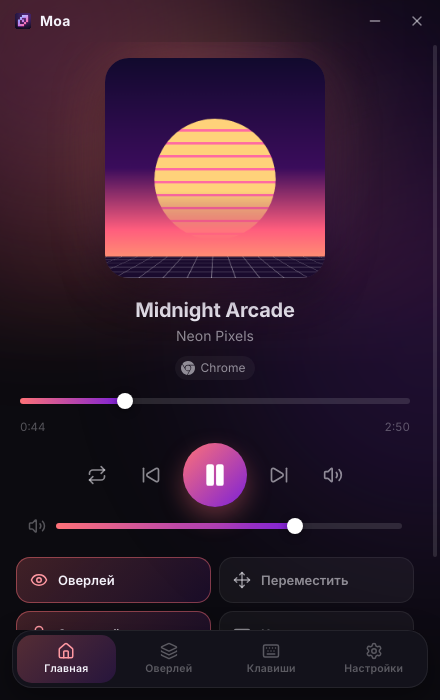
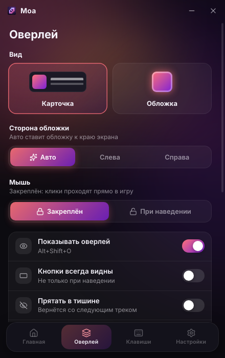
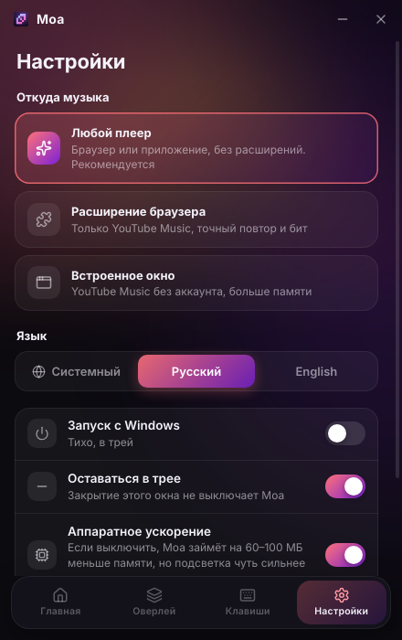
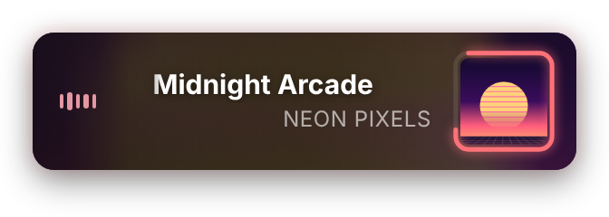
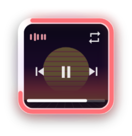
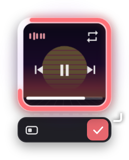

<div align="center">


**Музыкальный оверлей поверх игр, который работает с любым плеером.<br>YouTube Music, Spotify, Яндекс Музыка, SoundCloud… Управление глобальными биндами.**

[](https://github.com/godes2020/maol/releases/latest)
[](https://github.com/godes2020/maol/releases)
[](#-скачать-и-установить)
[](LICENSE)

[English](README.md) · **Русский**

[**⬇ Скачать для Windows**](https://github.com/godes2020/maol/releases/latest) · [Гайд по установке](docs/INSTALL.ru.md) · [Бинды](#-бинды) · [Память](#-память) · [Вопросы](#-вопросы)

<br>


</div>

---

## ✨ Возможности

|   |   |
|---|---|
| 🎵 **Любой плеер без настройки** | Moa читает медиа-управление Windows и подхватывает всё, что играет: YouTube Music, Spotify, Яндекс Музыку, SoundCloud, Apple Music, Deezer, VK, TIDAL — в любом браузере или приложении. Входишь в аккаунт на сайте сервиса или в его приложении, как обычно. Никаких расширений и паролей в Moa. |
| 🪟 **Оверлей в играх** | Маленький плеер поверх всех окон, как оверлей Discord. |
| 🖱 **Не мешает** | По умолчанию оверлей **закреплён**: клики проходят сквозь него прямо в игру, поэтому в Dota 2 или CS2 можно спокойно кликать где угодно. |
| 💿 **Два вида** | **Карточка** показывает обложку, название и исполнителя. **Обложка** показывает только обложку с кольцом прогресса, а при наведении кнопки появляются прямо поверх неё. |
| ↔️ **Встаёт в любой угол** | Размер меняется, если тянуть за уголок. В правой половине экрана карточка сама отзеркаливается, чтобы обложка была у края, а внизу экрана раскрывается вверх. |
| 🌈 **Плавная подсветка под бит** | Цвета берутся из обложки, свечение мягко «дышит» под бас. |
| ⌨️ **Глобальные бинды** | Пауза, следующий и предыдущий трек, перемотка, громкость, без звука и повтор работают везде, даже в полноэкранной игре. Любой бинд можно переназначить. |
| 🪶 **Лёгкая** | Moa запускает только то, что нужно: с оверлеем около 200 МБ памяти ([подробнее](#-память)). |

<div align="center">


<br><sub>Карточка · Обложка</sub>
</div>

## ⬇ Скачать и установить

1. Скачай **`Moa-Setup-x.y.z.exe`** из [**последнего релиза**](https://github.com/godes2020/maol/releases/latest) и запусти. Если Windows напишет *«Система Windows защитила ваш компьютер»*, нажми **Подробнее → Выполнить в любом случае**: у приложения пока нет подписи.
2. Moa откроет своё окно и добавит иконку в трей.
3. Включи музыку где угодно: на главном экране Moa нажми на сервис, он откроется в браузере. Войди там в аккаунт и нажми play. Приложения вроде Spotify тоже работают. Слева вверху появится оверлей. 🎉

> 📖 В [пошаговом гайде](docs/INSTALL.ru.md) также есть обновление, удаление и решение проблем.

### 🧪 Нативная версия 0.5.0 (тест)

Moa, переписанный на Rust, можно попробовать уже сейчас: **один `.exe` на 11 МБ без установки, около 10 МБ личной памяти в простое** (рабочий набор 38 МБ, замер на Windows в CI).
Скачай `Moa-0.5.0-preview-x64.exe` из [**пре-релиза v0.5.0**](https://github.com/godes2020/maol/releases/tag/v0.5.0) и запусти. Новое в этой сборке:
- **Встроенный плеер**: Яндекс Музыка, SoundCloud, VK или YouTube Music в окне WebView2 (*Настройки → Откуда музыка → Плеер в Moa → Открыть плеер*). Движок браузера загружается, только когда ты открываешь плеер.
- **Вход в Spotify** через официальный OAuth (PKCE); как получить Client ID, написано в гайде внутри приложения.

Это тестовая сборка: пожалуйста, пиши, что не работает, в [Issues](https://github.com/godes2020/maol/issues). Подробнее в [гайде по установке](docs/INSTALL.ru.md#нативная-версия-050-тест).

## 🏠 Окно Moa

<div align="center">



</div>

Открывается кликом по иконке в трее. Всё собрано в одном окне:

- **Главная**: текущий трек с перемоткой, громкостью и кнопками, плюс быстрые переключатели оверлея. Когда ничего не играет, здесь кнопки музыкальных сервисов, которые открываются в один клик.
- **Оверлей**: вид, сторона обложки, поведение мыши, подсветка, размер, прозрачность.
- **Клавиши**: все бинды, шаг перемотки и шаг громкости.
- **Настройки**: источник музыки, язык, автозапуск, экономия памяти.

Когда закрываешь окно, оно выгружается из памяти, а Moa продолжает работать в трее.

## ⌨ Бинды

Любой меняется на вкладке **Клавиши**: нажми на сочетание и зажми новое.

| Действие | По умолчанию |
|---|---|
| Пауза / играть | <kbd>Alt</kbd>+<kbd>Shift</kbd>+<kbd>K</kbd> |
| Следующий / предыдущий трек | <kbd>Alt</kbd>+<kbd>Shift</kbd>+<kbd>→</kbd> / <kbd>←</kbd> |
| Перемотка вперёд / назад на 5 с | <kbd>Alt</kbd>+<kbd>Shift</kbd>+<kbd>L</kbd> / <kbd>J</kbd> |
| Громче / тише | <kbd>Alt</kbd>+<kbd>Shift</kbd>+<kbd>↑</kbd> / <kbd>↓</kbd> |
| Без звука | <kbd>Alt</kbd>+<kbd>Shift</kbd>+<kbd>0</kbd> |
| Повтор | <kbd>Alt</kbd>+<kbd>Shift</kbd>+<kbd>R</kbd> |
| Показать / скрыть оверлей | <kbd>Alt</kbd>+<kbd>Shift</kbd>+<kbd>O</kbd> |
| **Переместить оверлей** | <kbd>Alt</kbd>+<kbd>Shift</kbd>+<kbd>M</kbd> |
| **Закрепить / открепить оверлей** | <kbd>Alt</kbd>+<kbd>Shift</kbd>+<kbd>U</kbd> |
| Открыть Moa | <kbd>Alt</kbd>+<kbd>Shift</kbd>+<kbd>Y</kbd> |

## 🪟 Оверлей

<table>
<tr>
<td align="center" width="50%"><br><b>Карточка</b></td>
<td align="center" width="50%"><br><b>Карточка справа</b><br><sub>Отзеркаливается сама, чтобы обложка была у края экрана.</sub></td>
</tr>
<tr>
<td align="center"><br><b>Полный плеер</b><br><sub>Раскрывается при наведении (если оверлей откреплён) или в режиме перемещения.</sub></td>
<td align="center"><br><b>Режим перемещения</b> (<kbd>Alt</kbd>+<kbd>Shift</kbd>+<kbd>M</kbd>)<br><sub>Перетаскивай, меняй размер за уголок, отзеркаливай ⇄, меняй вид, ✓ — готово.</sub></td>
</tr>
<tr>
<td align="center"> <br><b>Обложка</b><br><sub>При наведении поверх обложки появляются затемнение и кнопки. Ничего не раскрывается.</sub></td>
<td align="center"><br><b>Обложка в режиме перемещения</b></td>
</tr>
</table>

**Поведение мыши** (вкладка **Оверлей** или <kbd>Alt</kbd>+<kbd>Shift</kbd>+<kbd>U</kbd>):
- **Закреплён** (по умолчанию, для игр): оверлей полностью игнорирует мышь. Его кнопки работают только в режиме перемещения.
- **При наведении**: если навести мышь на оверлей, он раскроется и на кнопки можно нажимать.

## 🪶 Память

Замер с запущенным оверлеем и играющей музыкой. Это личная память всех процессов Moa на тестовой машине; на Windows цифры могут отличаться на ±20%.

| Что запущено | Память |
|---|---|
| Оверлей, ничего не играет | ~180 МБ |
| Оверлей, вид «Обложка», подсветка | ~210 МБ |
| Оверлей, вид «Карточка», подсветка | ~240 МБ |
| …без подсветки | ~200 МБ |
| + открыто окно Moa | +40–60 МБ (освобождается при закрытии) |
| *Для сравнения:* встроенное окно YouTube Music | ~450–700 МБ |

В нативной версии 0.5.0 Moa в простое занимает **~10 МБ личной памяти** (рабочий набор 38 МБ), и это один процесс. Встроенный плеер добавляет движок WebView2, только пока он открыт.

Как Moa экономит память:
- **Один маленький фоновый модуль** (`MoaMedia.exe`, 21 КБ, около 15 МБ памяти). Он читает медиа-управление Windows, меняет громкость плеера в микшере Windows и анализирует бит через звуковой API Windows.
- **Окно Moa создаётся, только когда ты его открываешь**, и полностью выгружается при закрытии.
- **Встроенное окно YouTube Music и сервер расширения работают только в своих режимах.**
- **Анализ бита работает, только пока играет музыка**, а анимация оверлея засыпает, когда ничего не двигается.
- **Аппаратное ускорение можно выключить** (*Настройки*). Тогда пропадает GPU-процесс, который на Windows занимает примерно 60–100 МБ, а подсветка чуть сильнее нагружает процессор.

## ❓ Вопросы

<details>
<summary><b>Какие плееры работают?</b></summary>

Все, что появляются в медиа-панели Windows (той, что всплывает при нажатии медиа-клавиши или изменении громкости): YouTube Music, Spotify (приложение и сайт), Яндекс Музыка (приложение и сайт), SoundCloud, Apple Music, Deezer, VK Музыка, TIDAL, YouTube и большинство других сайтов в Chrome, Edge, Яндекс Браузере, Opera, Brave, Firefox и Zen. Некоторые плееры не дают управлять повтором или не сообщают длительность трека — тогда Moa так и скажет, а не будет угадывать.
</details>

<details>
<summary><b>Почему нельзя войти в аккаунт прямо в Moa?</b></summary>

Google, Spotify и другие сервисы не разрешают сторонним программам играть музыку с твоим аккаунтом, а Google вообще блокирует вход во встроенных окнах приложений. Обойти это можно только обманом их защиты или копированием твоих cookie, и Moa не делает ни того, ни другого. Поэтому ты входишь там же, где всегда — на сайте в браузере или в официальном приложении, — а Moa просто следит за тем, что там играет. Кнопки на главном экране открывают каждый сервис в браузере в один клик.
</details>

<details>
<summary><b>Работает ли оверлей в полноэкранных играх (Dota 2, CS2…)?</b></summary>

Да, в режиме **«Окно без рамки»** или **«Полноэкранный оконный»**, который выглядит точно так же, как полный экран. В **эксклюзивном полноэкранном** режиме Windows не даёт ни одной программе рисовать поверх игры. Это возможно только внедрением кода в игру, а за такое банит античит. В Dota 2: *Настройки → Видео → Режим отображения → Окно без рамки*. Бинды работают в любом режиме.
</details>

<details>
<summary><b>Как работают громкость и подсветка без доступа к плееру?</b></summary>

Бинды громкости двигают ползунок самого плеера в микшере громкости Windows (например, Chrome или Spotify), а не общую громкость и не звук игры. Подсветка слушает звук, который играет Windows, и всё это происходит только на твоём ПК. Поэтому громкие звуки игры тоже могут заставить её пульсировать. Если это мешает, уменьши силу подсветки или выключи её на вкладке **Оверлей**.
</details>

<details>
<summary><b>Оверлей пишет «Ничего не играет»</b></summary>

Проверь, что музыка видна в медиа-панели Windows (нажми медиа-клавишу или клавишу громкости). Некоторые плееры показываются там только после первого нажатия play. Открой Moa: строка внизу главного экрана показывает, видит ли Moa медиа-управление Windows.
</details>

<details>
<summary><b>Бинд не срабатывает</b></summary>

Сочетание уже занято другой программой или игрой. На вкладке **Клавиши** такие сочетания подсвечены оранжевым — выбери другое. Если <kbd>Alt</kbd>+<kbd>Shift</kbd> переключает раскладку, поменяй сочетание для раскладки на <kbd>Win</kbd>+<kbd>Пробел</kbd> или переназначь бинды Moa на <kbd>Ctrl</kbd>+<kbd>Alt</kbd>+….
</details>

<details>
<summary><b>Какие ещё есть источники музыки?</b></summary>

В **Настройки → Откуда музыка**:
- **Любой плеер** (по умолчанию) — то, что описано выше.
- **Расширение браузера** — необязательное расширение Moa Connector для YouTube Music. Оно читает вкладку напрямую, поэтому повтор и бит берутся только из неё. Смотри [гайд по установке](docs/INSTALL.ru.md#необязательно-расширение-для-браузера).
- **Встроенное окно** — YouTube Music внутри Moa, без аккаунта (Google блокирует там вход). Занимает больше всего памяти.
</details>

<details>
<summary><b>Куда-то отправляются мои данные?</b></summary>

Нет. У Moa нет серверов, аналитики и телеметрии. Она общается только с Windows на твоём ПК (и с расширением через `127.0.0.1`, если ты им пользуешься). Настройки лежат в `%APPDATA%\Moa\config.json`.
</details>

## 🛠 Сборка из исходников

Нужен Node.js 20+. Чтобы собрать модуль медиа на Windows, нужен ещё .NET SDK.

```bash
git clone https://github.com/godes2020/maol.git
```

```bash
cd maol
```

```bash
npm install
```

```bash
dotnet publish helper/MoaMedia -c Release -o build/helper
```

```bash
npm start
```

На Linux или macOS режим «Любой плеер» можно попробовать с имитацией модуля: `MOA_MEDIA_HELPER=scripts/fake-media-helper.js npm start`.

Установщик собирается командой `npm run dist`, картинки и GIF для README — командой `npm run media`. Релизы собирает [GitHub Actions](.github/workflows/release.yml).

<details>
<summary>Структура проекта</summary>

```
src/
├── main/        # Главный процесс Electron: окна, трей, бинды, настройки, источники музыки
├── preload/     # Безопасные мосты между страницами и главным процессом
├── overlay/     # Оверлей (HTML/CSS/JS)
├── settings/    # Окно Moa
└── shared/      # Строки интерфейса (RU/EN), иконки
helper/MoaMedia/ # Модуль на C#: медиа-управление Windows, громкость приложения, анализ бита (WASAPI)
extension/       # Необязательное расширение Moa Connector для YouTube Music
scripts/         # check.js, capture-media.js, fake-media-helper.js
```
</details>

## 🗺 Планы

- [x] Любой плеер через медиа-управление Windows
- [x] Поддержка Firefox и Zen в расширении
- [ ] Нативная версия на Rust (0.5.0: тестирование)
- [ ] Подсветка только от звука плеера (захват звука отдельного приложения)
- [ ] Лайк / дизлайк и текст песни в оверлее
- [ ] Версии для macOS и Linux

## 📄 Лицензия

[MIT](LICENSE) © godes2020. Иконки: [Lucide](https://lucide.dev) (ISC) и [Simple Icons](https://simpleicons.org) (CC0).

<sub>Moa — неофициальный независимый проект. Он не связан с Google, YouTube, Spotify, Яндексом, SoundCloud, Apple, Deezer, VK и TIDAL, не одобрен и не спонсируется ими. Все названия и логотипы принадлежат их владельцам и показаны только для обозначения совместимости.</sub>
