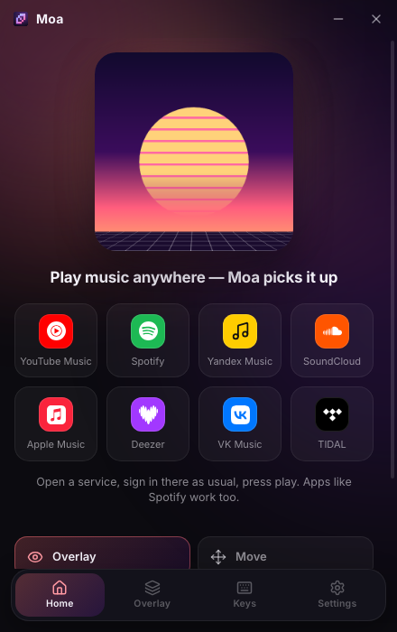
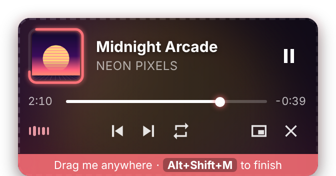

# Installing Moa

**English** · [Русский](INSTALL.ru.md) · [← Back to README](../README.md)

## Requirements

- Windows 10 (version 1809 or newer) or Windows 11, 64-bit
- Any music player: a website in any browser, or a desktop app such as Spotify or Yandex Music
- About 300 MB of free disk space

## 1. Download

Open the [**latest release**](https://github.com/godes2020/maol/releases/latest) and download one file from **Assets**:

| File | What it is |
|---|---|
| `Moa-Setup-x.y.z.exe` | **Recommended.** A normal installer with Start menu and desktop shortcuts and an uninstaller. |
| `Moa-x.y.z-portable.exe` | A single file that runs without installation. |
| `Moa-Connector-extension.zip`, `Moa-Connector-firefox.xpi` | The optional browser extension (see [below](#optional-browser-extension)). Most people don't need it. |

## 2. Install

1. Double-click `Moa-Setup-x.y.z.exe`.
2. **If Windows shows a blue “Windows protected your PC” window**, click **More info**, then **Run anyway**. This happens because Moa is a free open-source app without a paid code-signing certificate.
3. Choose the installer language and the folder, then click **Install** and **Finish**.
4. The Moa window opens, and an icon appears **in the tray** near the clock (it may be hidden behind the **^** arrow).

## 3. Play music

1. On Moa's home screen, click a service, for example **YouTube Music** or **Spotify**. It opens in your usual browser.
2. Sign in there as usual and play any song. A desktop app (Spotify, Yandex Music…) works just as well.
3. The home screen shows the track, and the overlay appears in the top-left corner. 🎉

No extensions, no logins in Moa: Moa follows whatever plays in the Windows media flyout.

## 4. Set it up for games

- **Position and size:** press <kbd>Alt</kbd>+<kbd>Shift</kbd>+<kbd>M</kbd>. Drag the overlay, and drag its corner to resize it. ⇄ mirrors the card, the second button switches the style, ✓ finishes. On the right half of the screen, the cover moves to the screen edge automatically.
- **Mouse:** by default the overlay is **locked**, so clicks go straight through it into the game. If you'd rather have it open when you point at it, choose *On hover* on the **Overlay** tab, or toggle with <kbd>Alt</kbd>+<kbd>Shift</kbd>+<kbd>U</kbd>.
- **Fullscreen:** set the game to **Borderless window** or **Windowed / Desktop-friendly fullscreen**. In Dota 2: *Settings → Video → Display Mode*. In exclusive fullscreen the overlay can't be drawn, but hotkeys still work.
- **Memory:** to save another 60–100 MB, turn off **Settings → Hardware acceleration** and restart Moa.

## Optional: browser extension

You only need this if you choose **Settings → Music source → Browser extension**. This mode reads a YouTube Music tab directly instead of the Windows media controls.

**Chrome, Edge, Yandex Browser, Opera, Brave**
1. On **Settings**, click the folder button next to **Extension folder**.
2. In the browser, open `chrome://extensions` (or `edge://extensions` in Edge) and turn on **Developer mode**.
3. Click **Load unpacked** and select that folder.
4. Open [music.youtube.com](https://music.youtube.com). If it was already open, reload it with <kbd>F5</kbd>.

**Firefox, Zen, LibreWolf, Floorp** (version 128 or newer)
- *Quick way, until the browser restarts:* open `about:debugging#/runtime/this-firefox`, click **Load Temporary Add-on…** and select `manifest.json` in the extension folder.
- *Permanent way:* download `Moa-Connector-firefox.xpi` from the release. Then open `about:config` and set `xpinstall.signatures.required` to **false**. Finally, open `about:addons`, click ⚙ → **Install Add-on From File…** and select the `.xpi`. This works in Zen, LibreWolf, Floorp, Developer Edition and Nightly; regular Firefox only allows the quick way.
- After installing either way, go to `about:addons` → **Moa Connector → Permissions** and allow **music.youtube.com**.

## Built-in window

**Settings → Music source → Built-in window** plays YouTube Music inside Moa. Google does not allow signing in there, so you can only listen without an account. This mode uses the most memory (about 450–700 MB).

## Native preview 0.5.0

A test build of the Rust rewrite. It runs side by side with nothing to install.

1. Download `Moa-0.5.0-preview-x64.exe` from the [v0.5.0 pre-release](https://github.com/godes2020/maol/releases/tag/v0.5.0) and run it (same **More info → Run anyway** step as above). Close the Electron Moa first: both use the same tray hotkeys.
2. **Built-in player:** *Settings → Music source → **Player in Moa***, pick a service and click **Open player**. It needs the Microsoft Edge WebView2 Runtime, which Windows 10/11 already include. Sign-ins are kept in `%APPDATA%\Moa\WebView2`. Closing the player window keeps the music playing; switching the source away frees it.
3. **Spotify:** create an app at [developer.spotify.com](https://developer.spotify.com/dashboard), add the redirect URI `http://127.0.0.1:47825/callback`, paste its Client ID in *Settings → Spotify account* and click **Sign in with Spotify**. Moa uses the official PKCE sign-in and keeps only the refresh token.
4. Settings are in `%APPDATA%\Moa`. To remove the preview, delete the `.exe` and that folder.

## Updating

Download the new `Moa-Setup-x.y.z.exe` and run it. It installs over the old version and keeps your settings.

> To get notified about new versions, click **Watch → Custom → Releases** at the top of the repository page.

## Uninstalling

1. **Settings → Apps → Installed apps → Moa → Uninstall.**
2. Optionally, delete `%APPDATA%\Moa`, which holds the settings.
3. If you installed the extension, remove **Moa Connector** from your browser.

## Troubleshooting

| Problem | Fix |
|---|---|
| “Nothing playing” | Check that the music appears in the Windows media flyout (press a volume key). Some players appear only after you press play. The line at the bottom of Moa's home screen shows whether Moa sees the media controls. |
| “Windows media unavailable” | Moa needs Windows 10 version 1809 or newer. Make sure `MoaMedia.exe` is in the Moa folder and that your antivirus did not quarantine it. |
| Volume hotkeys do nothing | Moa changes the player's slider in the Windows volume mixer. This works for players that output sound themselves (browsers, Spotify…). Check the mixer: the player's slider should move. |
| Repeat says it's not supported | That player doesn't let other apps control repeat. Use the button in the player itself. |
| The glow reacts to game sounds | The glow listens to everything Windows plays. Lower **Glow strength** or turn the glow off on the **Overlay** tab. |
| The overlay is invisible in a game | Switch the game to *Borderless* mode, and check the overlay is on with <kbd>Alt</kbd>+<kbd>Shift</kbd>+<kbd>O</kbd>. If it went off-screen, use **Overlay → Reset**. |
| A hotkey does nothing | Another program uses it. It's highlighted orange on the **Keys** tab, so pick a different one. |
| Antivirus warns about the file | That's a false positive for unsigned apps. Download only from this repository's Releases page. |

Still stuck? [Open an issue](https://github.com/godes2020/maol/issues/new) and describe what happened, including your Windows version, player and Moa version.
