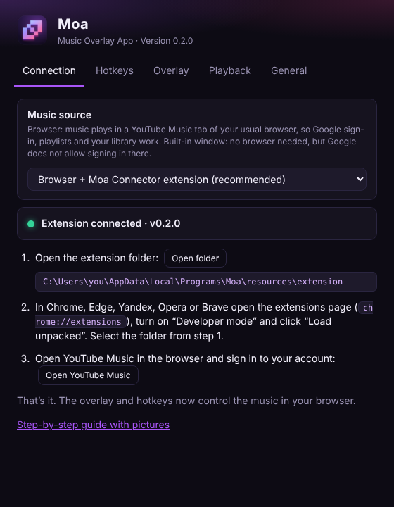

# Installing Moa

**English** · [Русский](INSTALL.ru.md) · [← Back to README](../README.md)

## Requirements

- Windows 10 or Windows 11 (64-bit)
- A browser: Google Chrome, Microsoft Edge, Yandex Browser, Opera, Brave, or Firefox / Zen 128+
- About 300 MB of free disk space

## 1. Download

Open the [**latest release**](https://github.com/godes2020/maol/releases/latest) and download one file from **Assets**:

| File | What it is |
|---|---|
| `Moa-Setup-x.y.z.exe` | **Recommended.** A normal installer with Start menu and desktop shortcuts and an uninstaller. |
| `Moa-x.y.z-portable.exe` | A single file that runs without installation. |
| `Moa-Connector-extension.zip` | The browser extension on its own. The installer already includes it, so you only need this zip with the portable version. |
| `Moa-Connector-firefox.xpi` | The same extension packed for Firefox and Zen. |

## 2. Install Moa

1. Double-click `Moa-Setup-x.y.z.exe`.
2. **If Windows shows a blue “Windows protected your PC” window**, click **More info**, then **Run anyway**. This happens because Moa is a free open-source app without a paid code-signing certificate.
3. Choose the installer language and the folder, then click **Install** and **Finish**.
4. Moa starts **in the tray**, the area near the clock. The icon may be hidden behind the **^** arrow. Moa has no window of its own, just like Discord's overlay. **Settings → Connection** opens automatically the first time.

## 3. Connect your browser

Moa plays music in **your usual browser**, so you sign in to Google there as usual. The small **Moa Connector** extension links that tab to Moa.

1. In **Settings → Connection**, click **Open folder**. A folder named `extension` opens. You need this folder in step 4.
2. In the browser, open the extensions page by typing it into the address bar:
   - Chrome, Yandex, Opera, Brave: `chrome://extensions`
   - Edge: `edge://extensions`
3. Turn on **Developer mode**. The switch is in the top-right corner in Chrome, or on the left in Edge.
4. Click **Load unpacked** and select the `extension` folder from step 1.
5. **Moa Connector** appears in the list. Pin it with the 🧩 icon if you'd like to see its status.
6. Open [music.youtube.com](https://music.youtube.com), sign in and play any song.

The status in **Settings → Connection** turns green (**Extension connected**), and the overlay appears in the top-left corner. 🎉

> If the YouTube Music tab was already open before you installed the extension, reload it with <kbd>F5</kbd>.
> Chrome may sometimes remind you that developer-mode extensions are enabled. That's normal. Choose to keep the extension.

### Firefox, Zen, LibreWolf, Floorp

These browsers need Firefox 128 or newer and install the extension differently.

**Quick way (until the browser restarts).**
1. Type `about:debugging#/runtime/this-firefox` into the address bar.
2. Click **Load Temporary Add-on…**.
3. Open the `extension` folder from step 1 and select **`manifest.json`**.

Firefox removes temporary add-ons when it closes, so you repeat these steps after each restart.

**Permanent way.**
1. Download **`Moa-Connector-firefox.xpi`** from the [latest release](https://github.com/godes2020/maol/releases/latest).
2. Open `about:config`, accept the warning, find `xpinstall.signatures.required` and set it to **false**.
3. Open `about:addons`, click the ⚙ gear and choose **Install Add-on From File…**, then select the `.xpi`.

Zen, LibreWolf, Floorp, Firefox Developer Edition and Nightly allow this. Regular Firefox ignores the setting and says the add-on *could not be verified*, so use the quick way there.

**After installing either way:** in `about:addons` open **Moa Connector → Permissions** and turn on **Access your data for music.youtube.com**. Firefox doesn't grant it on its own, and without it the extension can't see the tab. Then reload the YouTube Music tab.

## 4. Set it up for games

- **Mouse:** by default the overlay is **locked**. Clicks go straight through it into the game, so it never gets in the way. To press its buttons, enter move mode with <kbd>Alt</kbd>+<kbd>Shift</kbd>+<kbd>M</kbd>. If you'd rather have it open when you point at it, choose *Opens on hover* in **Settings → Overlay**, or toggle with <kbd>Alt</kbd>+<kbd>Shift</kbd>+<kbd>U</kbd>.
- **Position:** press <kbd>Alt</kbd>+<kbd>Shift</kbd>+<kbd>M</kbd>, drag the overlay, and press <kbd>Alt</kbd>+<kbd>Shift</kbd>+<kbd>M</kbd> again.
- **Fullscreen:** set the game to **Borderless window** or **Windowed / Desktop-friendly fullscreen**. In Dota 2: *Settings → Video → Display Mode*. In exclusive fullscreen the overlay can't be drawn, but hotkeys still work.
- **Style:** pick *Card* or *Cover only* in **Settings → Overlay**.

## Built-in window (optional)

If you don't want to use a browser, switch **Settings → Connection → Music source** to **Built-in window**. Moa then plays YouTube Music itself. However, **Google does not allow signing in** inside app windows, so you can only listen without an account in this mode. The window is hidden by default; open it from the tray, or turn on **Settings → General → Show the Moa window**.

## Updating

Download the new `Moa-Setup-x.y.z.exe` and run it. It installs over the old version and keeps your settings. Then go to `chrome://extensions` and click the **↻ reload** button on **Moa Connector**. The extension folder is updated together with Moa.

> To get notified about new versions, click **Watch → Custom → Releases** at the top of the repository page.

## Uninstalling

1. **Settings → Apps → Installed apps → Moa → Uninstall.**
2. In `chrome://extensions`, remove **Moa Connector**.
3. Optionally, delete `%APPDATA%\Moa`, which holds the settings.

## Troubleshooting

| Problem | Fix |
|---|---|
| The overlay says “Nothing playing” | Moa must be running (tray), the extension enabled, and a music.youtube.com tab open. Reload the tab with <kbd>F5</kbd>. The extension's popup shows what's missing. |
| Status says “Extension is not connected” | Make sure **Moa Connector** is enabled in `chrome://extensions` and click its **↻** button. Restart Moa. |
| “Moa could not start its local connection: port 47823 is busy” | Another copy of Moa or another program is using the port. Quit Moa from the tray, then start it again, or restart your PC. |
| The overlay is invisible in a game | Switch the game to *Borderless* mode, and check the overlay is on with <kbd>Alt</kbd>+<kbd>Shift</kbd>+<kbd>O</kbd>. If it went off-screen, use **Settings → Overlay → Reset position**. |
| A hotkey does nothing | Another program uses it. It's highlighted orange in **Settings → Hotkeys**, so pick a different one. |
| Antivirus warns about the file | That's a false positive for unsigned apps. Download only from this repository's Releases page. |

Still stuck? [Open an issue](https://github.com/godes2020/maol/issues/new) and describe what happened, including your Windows, browser and Moa versions.
