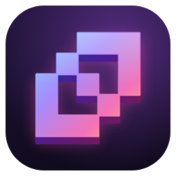
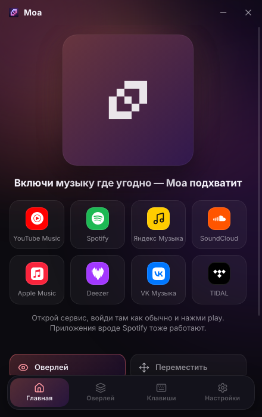
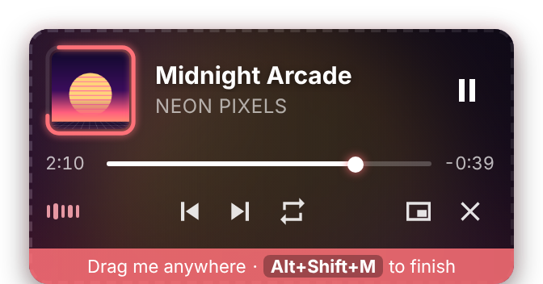

# Установка Moa

[English](INSTALL.md) · **Русский** · [← Назад к README](../README.ru.md)

## Что нужно

- Windows 10 (версия 1809 или новее) или Windows 11, 64-бит
- Любой музыкальный плеер: сайт в любом браузере или приложение вроде Spotify или Яндекс Музыки
- Около 300 МБ свободного места

## 1. Скачай

Открой [**последний релиз**](https://github.com/godes2020/maol/releases/latest) и скачай из раздела **Assets** один файл:

| Файл | Что это |
|---|---|
| `Moa-Setup-x.y.z.exe` | **Рекомендуется.** Обычный установщик с ярлыками в «Пуск» и на рабочем столе и программой удаления. |
| `Moa-x.y.z-portable.exe` | Один файл, работает без установки. |
| `Moa-Connector-extension.zip`, `Moa-Connector-firefox.xpi` | Необязательное расширение для браузера (смотри [ниже](#необязательно-расширение-для-браузера)). Большинству не нужно. |

## 2. Установи

1. Запусти `Moa-Setup-x.y.z.exe` двойным кликом.
2. **Если Windows покажет синее окно «Система Windows защитила ваш компьютер»**, нажми **Подробнее**, а затем **Выполнить в любом случае**. Так бывает, потому что Moa — бесплатное приложение с открытым кодом без платного сертификата подписи.
3. Выбери язык установщика и папку, нажми **Установить** и **Готово**.
4. Откроется окно Moa, а **в трее** у часов появится иконка (она может прятаться под стрелкой **^**).

## 3. Включи музыку

1. На главном экране Moa нажми на сервис, например **YouTube Music** или **Spotify**. Он откроется в твоём обычном браузере.
2. Войди там в аккаунт как обычно и включи любую песню. Приложение (Spotify, Яндекс Музыка…) подойдёт точно так же.
3. На главном экране появится трек, а слева вверху — оверлей. 🎉

Никаких расширений и входа в Moa: она следит за тем, что играет в медиа-панели Windows.

## 4. Настрой под игры

- **Место и размер:** нажми <kbd>Alt</kbd>+<kbd>Shift</kbd>+<kbd>M</kbd>. Перетащи оверлей, а чтобы поменять размер, тяни за уголок. ⇄ отзеркаливает карточку, вторая кнопка меняет вид, ✓ — готово. В правой половине экрана обложка сама переезжает к краю.
- **Мышь:** по умолчанию оверлей **закреплён**, и клики проходят сквозь него прямо в игру. Если удобнее, чтобы он раскрывался при наведении, выбери *При наведении* на вкладке **Оверлей** или переключай биндом <kbd>Alt</kbd>+<kbd>Shift</kbd>+<kbd>U</kbd>.
- **Полный экран:** включи в игре **«Окно без рамки»** или **«Полноэкранный оконный»**. В Dota 2: *Настройки → Видео → Режим отображения*. В эксклюзивном полноэкранном режиме оверлей нарисовать нельзя, но бинды работают.
- **Память:** чтобы сэкономить ещё 60–100 МБ, выключи **Настройки → Аппаратное ускорение** и перезапусти Moa.

## Необязательно: расширение для браузера

Нужно, только если ты выберешь **Настройки → Откуда музыка → Расширение браузера**. В этом режиме Moa читает вкладку YouTube Music напрямую, а не медиа-управление Windows.

**Chrome, Edge, Яндекс Браузер, Opera, Brave**
1. В **Настройках** нажми кнопку с папкой рядом с **Папка расширения**.
2. В браузере открой `chrome://extensions` (в Edge — `edge://extensions`) и включи **Режим разработчика**.
3. Нажми **Загрузить распакованное расширение** и выбери эту папку.
4. Открой [music.youtube.com](https://music.youtube.com). Если вкладка уже была открыта, обнови её клавишей <kbd>F5</kbd>.

**Firefox, Zen, LibreWolf, Floorp** (версия 128 или новее)
- *Быстро, до перезапуска браузера:* открой `about:debugging#/runtime/this-firefox`, нажми **Загрузить временное дополнение…** и выбери `manifest.json` в папке расширения.
- *Навсегда:* скачай из релиза `Moa-Connector-firefox.xpi`. Затем в `about:config` поставь `xpinstall.signatures.required` в **false**. После этого открой `about:addons`, нажми ⚙ → **Установить дополнение из файла…** и выбери `.xpi`. Так можно в Zen, LibreWolf, Floorp, Developer Edition и Nightly; в обычном Firefox работает только быстрый способ.
- После установки любым способом открой `about:addons` → **Moa Connector → Разрешения** и разреши доступ к **music.youtube.com**.

## Встроенное окно

**Настройки → Откуда музыка → Встроенное окно** играет YouTube Music внутри Moa. Google не даёт там войти в аккаунт, поэтому слушать можно только без него. Этот режим занимает больше всего памяти (примерно 450–700 МБ).

## Нативная версия 0.5.0 (тест)

Тестовая сборка Moa, переписанного на Rust. Устанавливать ничего не нужно.

1. Скачай `Moa-0.5.0-preview-x64.exe` из [пре-релиза v0.5.0](https://github.com/godes2020/maol/releases/tag/v0.5.0) и запусти (шаг **Подробнее → Выполнить в любом случае** такой же, как выше). Сначала закрой обычный Moa: у них общие бинды.
2. **Встроенный плеер:** *Настройки → Откуда музыка → **Плеер в Moa***, выбери сервис и нажми **Открыть плеер**. Нужен Microsoft Edge WebView2 Runtime, он уже есть в Windows 10/11. Входы в аккаунты хранятся в `%APPDATA%\Moa\WebView2`. Если закрыть окно плеера, музыка продолжит играть; если сменить источник, плеер выгрузится.
3. **Spotify:** создай приложение на [developer.spotify.com](https://developer.spotify.com/dashboard), добавь Redirect URI `http://127.0.0.1:47825/callback`, вставь его Client ID в *Настройки → Аккаунт Spotify* и нажми **Войти через Spotify**. Moa использует официальный вход PKCE и хранит только refresh-токен.
4. Настройки лежат в `%APPDATA%\Moa`. Чтобы удалить тестовую версию, удали `.exe` и эту папку.

## Обновление

Скачай новый `Moa-Setup-x.y.z.exe` и запусти его. Новая версия встанет поверх старой, настройки сохранятся.

> Чтобы получать уведомления о новых версиях, нажми вверху страницы репозитория **Watch → Custom → Releases**.

## Удаление

1. **Параметры → Приложения → Установленные приложения → Moa → Удалить.**
2. По желанию удали папку `%APPDATA%\Moa` с настройками.
3. Если ставил расширение, удали **Moa Connector** из браузера.

## Если что-то не так

| Проблема | Решение |
|---|---|
| «Ничего не играет» | Проверь, что музыка видна в медиа-панели Windows (нажми клавишу громкости). Некоторые плееры появляются там только после нажатия play. Строка внизу главного экрана Moa показывает, видит ли Moa медиа-управление. |
| «Медиа Windows недоступны» | Нужна Windows 10 версии 1809 или новее. Проверь, что `MoaMedia.exe` лежит в папке Moa и антивирус не отправил его в карантин. |
| Бинды громкости не работают | Moa двигает ползунок плеера в микшере громкости Windows. Это работает с плеерами, которые сами выводят звук (браузеры, Spotify…). Открой микшер: ползунок плеера должен двигаться. |
| Повтор пишет, что не поддерживается | Этот плеер не даёт другим программам управлять повтором. Используй кнопку в самом плеере. |
| Подсветка реагирует на звуки игры | Подсветка слушает всё, что играет Windows. Уменьши **Силу подсветки** или выключи подсветку на вкладке **Оверлей**. |
| Оверлея не видно в игре | Переключи игру в режим *без рамки* и проверь, что оверлей включён (<kbd>Alt</kbd>+<kbd>Shift</kbd>+<kbd>O</kbd>). Если он уехал за экран, нажми **Оверлей → Сбросить**. |
| Бинд не срабатывает | Сочетание занято другой программой. На вкладке **Клавиши** оно подсвечено оранжевым, выбери другое. |
| Антивирус ругается на файл | Это ложное срабатывание на приложение без подписи. Скачивай только со страницы Releases этого репозитория. |

Не помогло? [Создай issue](https://github.com/godes2020/maol/issues/new) и опиши, что случилось, указав версию Windows, плеер и версию Moa.
